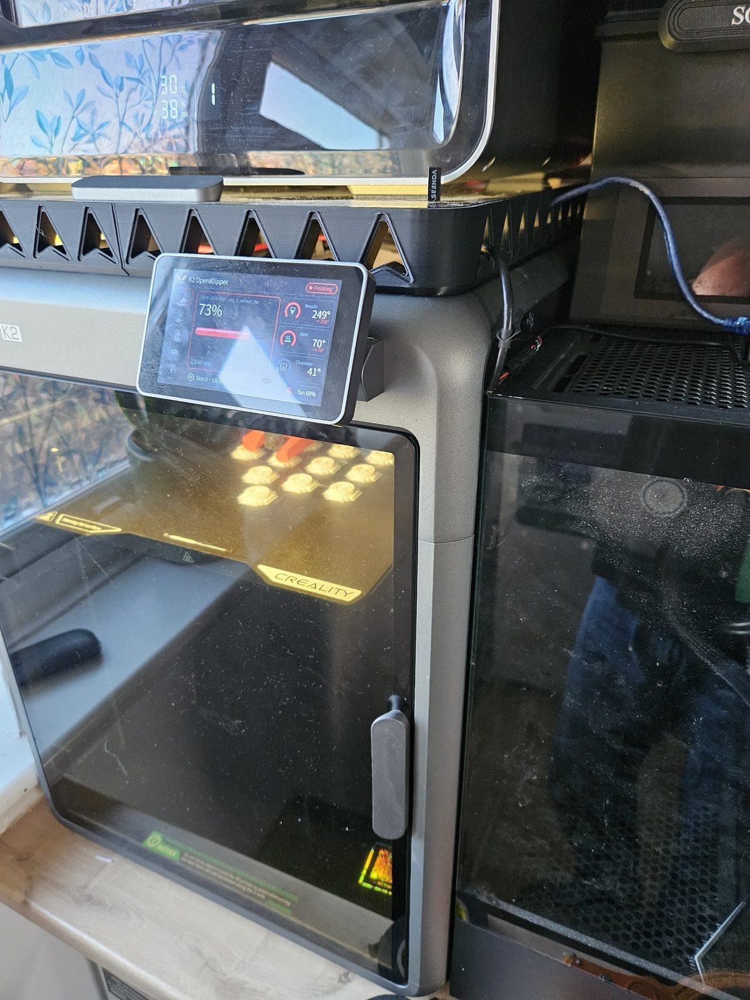
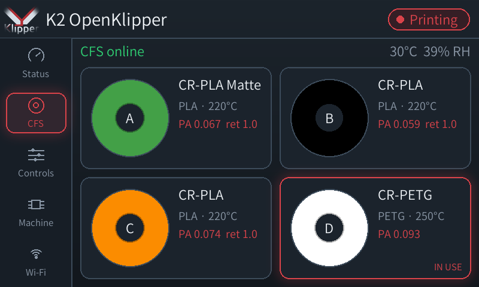
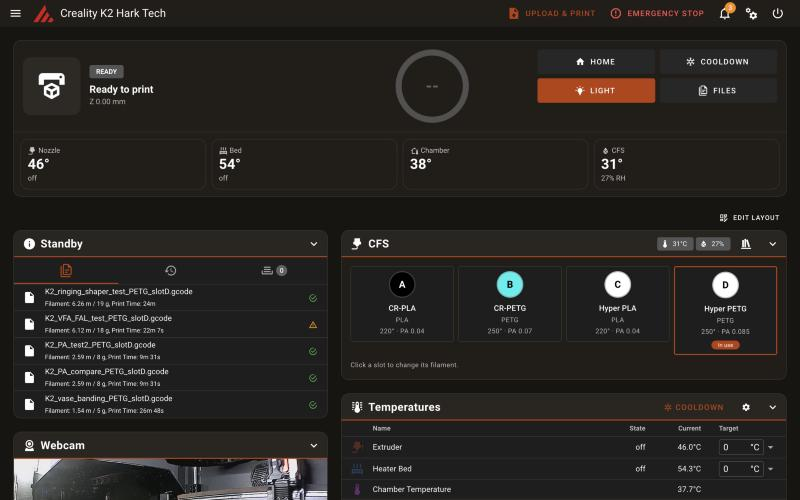

# K2 OpenKlipper

**Open-source mainline Klipper for the Creality K2: strain-gauge probe, CFS
multi-filament box, closed-loop motors and touchscreen, without Creality's
closed control stack.**

The Creality K2 normally runs a closed fork of Klipper: the nozzle probe
(`prtouch_v3`), the CFS box driver, the closed-loop X/Y/E motor control and the
screen are compiled binaries, and Creality's `master-server` drives the
printer. This project replaces all of that with **upstream Klipper plus open
Python modules**, so the K2 can be driven, tuned and extended like any other
Klipper printer: Mainsail, Moonraker, your own macros, OrcaSlicer, Klipper
input shaping and pressure advance.

It runs on the printer's own board. No external host or hardware changes are
needed, and the stock firmware stays installed for a one-command rollback.
Optionally, Klipper can run on a separate PC over one USB cable
([external host](docs/EXTERNAL-HOST.md)).

**Install: [step-by-step guide](docs/INSTALL.md)**, about 15 minutes.

<p>


</p>

> **Status: alpha (v0.4.0-alpha.1).** It is in daily use on one K2 (F021,
> K2 / K2 Combo) and has completed full prints, CFS loads and multi-slot jobs.
> It is still experimental printer firmware: supervise prints, keep the
> rollback path, and read [Project status](docs/PROJECT-STATUS.md) first.



## What works

| Area | Open implementation |
| --- | --- |
| Klipper host | Upstream Klipper (pinned commit in `K2-BUILD-MANIFEST`) |
| Z probe | Open re-implementation of the K2 nozzle strain gauge (PRTouch): precise Z home, adaptive mesh, contamination guard |
| Z reference | PA15 optical bottom switch, used at every print start ([start sequence](docs/START-SEQUENCE.md)) |
| X/Y/E motors | Closed-loop motor bus: wake-up, stall homing, parameter read/write, telemetry ([motor controller](docs/MOTOR-CONTROLLER.md)) |
| CFS | Load, purge, unload, tool changes, steady feed, take-up tension, per-slot filament records, error retry ([CFS protocol](docs/CFS-PROTOCOL.md)) |
| Pressure advance | **Measured with the nozzle strain gauge**: `PA_CAL_RUN SLOT=x` picks PA per CFS slot ([PA calibration](docs/PA-CALIBRATION.md)) |
| Input shaping | Head accelerometer (LIS2DW on the nozzle board) via `[lis2dw_k2]`, standard `SHAPER_CALIBRATE` |
| Touchscreen | Hark Screen: themeable landscape UI, CFS slots, load/purge, PA calibration, Wi-Fi ([screen and camera](docs/SCREEN-AND-CAMERA.md)) |
| Camera | Chamber camera as a plain MJPEG stream in Mainsail (and usable by AI failure detection) |
| Klipper extras | Ideas from Kalico as add-on modules: `RELOAD_GCODE_MACROS`, `PID_PROFILE` per CFS slot material, `BED_MESH_CHECK` |
| Klipper on a separate PC | Optional: Klipper and Moonraker on any Linux PC over one USB cable; the K2 board only relays its serial ports ([external host](docs/EXTERNAL-HOST.md)) |
| Print safety | `[hark_safety]`: pauses on a dead hotend or part fan, cancels on an X/Y motor fault, pauses on an extruder fault (clog or jam) |
| Runout refill | When a reel runs out, another CFS slot with the same material and colour takes over and the print carries on (else it pauses), like stock. A warning names the next slot as soon as the reel's end passes the CFS |
| Chamber fan | The exhaust fan vents the chamber above 35C while printing, like stock; the slicer's chamber target (M141/M191) raises it |
| Updates | Tested releases from GitHub: an Update button in Mainsail and on the touchscreen; your settings live in `printer-overrides.cfg` and are kept |
| AI failure detection | Optional, on the host PC: Obico model every 10 s plus a local vision model (Qwen3-VL) as a second opinion ([ai-detect](tools/ai-detect/)) |
| Web UI | [Mainsail Hark K2 edition](https://github.com/grant0013/mainsail) (CFS panel, control centre, appearance presets) on port 4409, Moonraker on 7126 |

## What is different from stock

- **One heat cycle before probing.** Load and purge at print temperature over
  the chute, cool-wipe once, measure Z with a clean nozzle, scrape on the bed
  strip, then mesh. That is about 5 minutes faster than stock and causes less
  ooze.
- **Pressure advance from real nozzle pressure.** The strain gauge measures
  the pressure response to flow steps; the result is stored per CFS slot.
  Creality only offers camera-based flow calibration, and only on the K2 Plus.
- **Everything is visible and editable** in Mainsail: macros, CFS slot data,
  motor parameters.

## Supported hardware

| Model | Status |
| --- | --- |
| K2 / K2 Combo (F021) | Developed and tested here |
| K2 without a CFS (rear spool) | Supported: found automatically at each start ([details](docs/INSTALL.md#printers-without-a-cfs)); tested on our K2 with the CFS unplugged |
| K2 Pro (F012) | Same motor tuning and boards as the K2 in Creality's config; untested |
| K2 Plus (F008) | Different Z system (closed-loop Z) and camera; untested |

Earlier snapshots described the test machine as a K2 Plus; it is an F021 K2.

## Install and rollback

**Step-by-step guide: [docs/INSTALL.md](docs/INSTALL.md)** (root access on the
touchscreen, one SSH session, about 15 minutes). In short, on the K2 as root:

```sh
python3 -c "import urllib.request as u; open('/tmp/install.sh','wb').write(u.urlopen('https://raw.githubusercontent.com/grant0013/K2-OpenKlipper/main/install.sh').read())" && sh /tmp/install.sh --check
sh /tmp/install.sh                                        # install (backs up first)
sh /mnt/UDISK/k2-mainline-20260729-v62/uninstall.sh      # back to stock
```

It installs next to the stock firmware and backs up every system file it
changes. Never install, switch or uninstall while a job is printing or paused.
See [OPEN-STACK.md](OPEN-STACK.md) for the architecture and
[CONTRIBUTING.md](CONTRIBUTING.md) before testing on your own printer.

## Warnings learned the hard way

- **Do not enable the motor speed-loop "FAL" parameter (ID 0x5e).** It worked
  in motion, but left idle it locked both X/Y motor controllers off the bus
  until a full power cycle. See [motor controller](docs/MOTOR-CONTROLLER.md).
- **The CFS feed must be armed for any sustained extrusion.** Without it the
  extruder drags filament off the spool against the take-up tension and slips.
- **Never write motor flash parameters** (opcode 07). Everything here writes
  RAM only, so a power cycle always restores factory values.
- **The board MCUs still run Creality's firmware** (Klipper warns about
  deprecated features). It carries the K2-specific commands this stack depends
  on, so do not flash stock Klipper MCU firmware.

## OrcaSlicer

Use:

```gcode
START_PRINT EXTRUDER_TEMP=[nozzle_temperature_initial_layer] BED_TEMP=[bed_temperature_initial_layer_single] TOOL=[initial_no_support_extruder]
```

Replace Creality's legacy **Change filament G-code** with:

```gcode
G90
G1 Z{max(z_after_toolchange, 0.6)} F600
```

The full explanation is in `config/ORCA-K2-PROFILE.cfg`.

## Repository layout

- `klippy/` - pinned upstream Klipper plus the K2 modules in `klippy/extras/`:
  `prtouch_mainline.py` + `prtouch_open/` (strain-gauge probe), `k2_cfs.py` +
  `hark_cfs_slots.py` (CFS and slot records), `k2_motor_bus.py` (closed-loop
  motors), `k2_z_align.py` (bottom reference), `lis2dw_k2.py` (head
  accelerometer), `pa_pressure_log.py` + `pa_analysis.py` (PA calibration)
- `config/mainline_stage2.cfg` - the full working printer configuration and
  macros (start sequence, CFS, nozzle cleaning, purge line, PA calibration)
- `harkscreen/` - touchscreen app; `harkcam/` - camera streamer
- `host/` - running Klipper on a separate Linux PC: the K2-side USB relay
  and boot script, host udev rule, systemd units, nginx site and config overrides
- `tools/` - deployment helper, PA plotting and simulation, motor parameter
  scan and A/B test tools, boot-animation generator, `ai-detect/` print-failure
  watcher
- `system/` - Mainsail (Hark K2 edition build, source in
  [grant0013/mainsail](https://github.com/grant0013/mainsail)), Moonraker
  service and compatibility patches
- `docs/` - protocol and design notes:
  [CFS](docs/CFS-PROTOCOL.md), [PRTouch](docs/PRTOUCH.md),
  [motor controller](docs/MOTOR-CONTROLLER.md),
  [PA calibration](docs/PA-CALIBRATION.md),
  [start sequence](docs/START-SEQUENCE.md),
  [screen and camera](docs/SCREEN-AND-CAMERA.md),
  [external host](docs/EXTERNAL-HOST.md),
  [project status](docs/PROJECT-STATUS.md)

## Help wanted

- Testing on K2 Pro (F012) and K2 Plus (F008), and on other firmware revisions
- Motor controller parameters: the notch filters and ripple compensator are
  locked in the motor firmware; any safe way to reach them
- CFS electrical interface and multi-box setups
- Long-print, power-loss and runout recovery testing

Use the issue templates and include exact versions, logs and the phase being
tested. Do not publish credentials, serial numbers, Wi-Fi details or other
private data.

## Legal and what is not in this repository

No Creality code is included or redistributed: no `.so` wrappers, no
firmware images, no decompiled code and no Creality scripts (the installer
edits the printer's own files in place, after backing them up). Protocol
knowledge comes from observing the printer and its traffic, studying how
Creality's software on the printer behaves, Creality's published
configuration and GPL sources, and interoperability testing, as UK law
(CDPA 1988 s.50B and s.50BA) allows for interoperability. The Klipper-derived code is GNU GPLv3 (see
`COPYING`); bundled third-party components keep their own licences (see
`THIRD_PARTY.md`).

Not affiliated with or endorsed by Creality. Modifying printer software may
void Creality's warranty and can damage hardware. You use this at your own
risk.

## Credits

Built by [Hark Tech](https://harktech.co.uk) (Grant Harkness), a UK 3D
printing and electronics repair workshop, on top of Klipper (Kevin O'Connor
and contributors), Moonraker and Mainsail.

With thanks to:

- [Jacob10383](https://github.com/Jacob10383/k2-plus-custom-firmware) (K2
  Plus custom firmware, GPLv3): motor reply decoding and fault handling,
  PRTouch tap selection and probe safety, and CFS status codes, runout purge
  and path tracking are adapted from his code. Each file that uses it says so.
- Dmitry Butyugin (Klipper): `pa_tester`, the load-cell pressure advance
  calibration behind `PA_CAL_STATIC`.
- CNC Kitchen (Stefan Hermann): the PATuner method behind `PA_CAL_RUN`.

*Keywords: Creality K2, K2 Combo, K2 Pro, K2 Plus, mainline Klipper, open
source firmware, root, PRTouch, strain gauge probe, CFS, Creality Filament
System, multi-material, closed-loop servo, pressure advance calibration, input
shaper, Mainsail, Moonraker, OrcaSlicer.*
