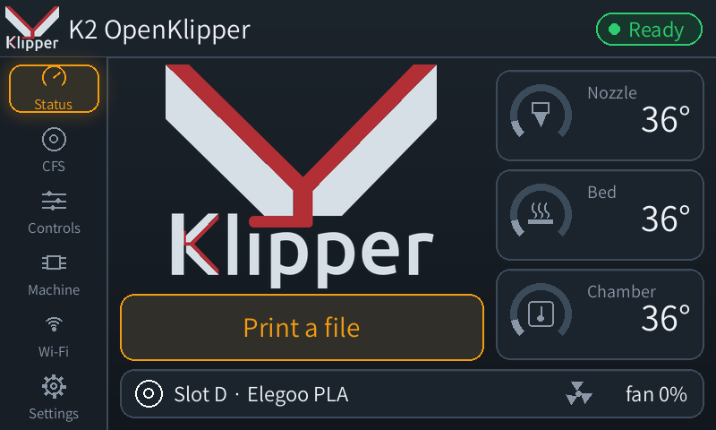
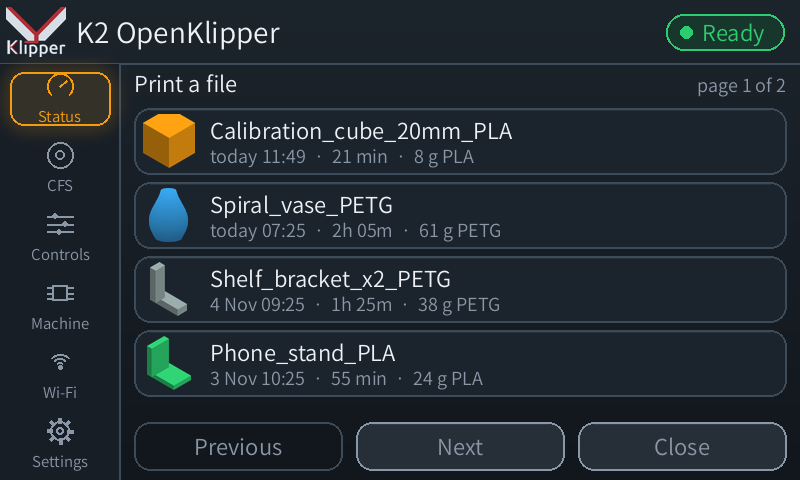
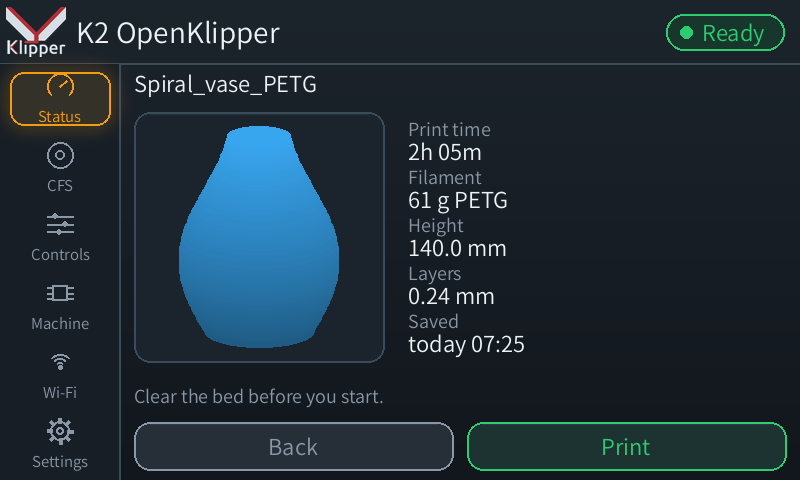
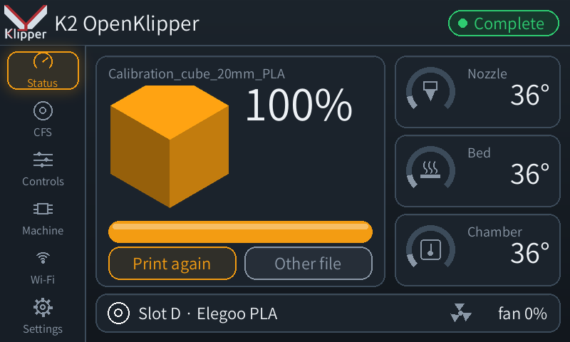

# K2 OpenKlipper v0.4.19-alpha.1

**Start a print from the touchscreen, and a quicker screen.**

## Print a file

The Status page has a **Print a file** button when the printer is idle. It
lists your print files newest first, four to a page, each with the slicer's
thumbnail, when it was saved, the print time and the filament. Tap one to
see a large preview and its details, then **Print** to start it.

| | |
| --- | --- |
|  |  |
|  |  |

- After a print, **Print again** opens the same file's details (so you
  clear the bed first) and **Other file** opens the list.
- The button is hidden while printing or while the printer is busy (homing,
  cleaning). If Moonraker refuses a start, the reason shows under the
  preview.
- Thanks to masteryodha for pointing out that the screen had no way to pick
  a file ([#3](https://github.com/grant0013/K2-OpenKlipper/issues/3)).

## A quicker touchscreen

Measured on the K2's own processor, with the same look:

| | Before | Now |
| --- | --- | --- |
| Change page | 513 ms | 219 ms |
| Open a box (temperatures, fans, a question) | 806 ms | 251 ms |
| Redraw the Status page | 93 ms | 61 ms |

The logo and text sizes are worked out once instead of on every frame, the
glow round a box and the dimming behind it are drawn in a cheaper way, and the
page slide is shorter (3 frames instead of 7) with boxes appearing at once.
`transitions: smooth` in `harkscreen.cfg` brings back the longer
animations, and `transitions: off` drops the slide.

## Update

Mainsail's Update button, the touchscreen's Machine page, or
`OKL_UPDATE CONFIRM=1` in the console. The touchscreen restarts with the
new version; your `harkscreen.cfg` and `printer-overrides.cfg` are kept.
With Klipper on a separate PC, the K2's screen brings itself up to date
from the PC's version while idle.

Everything from v0.4.18-alpha.3 is included, including the camera fix. See
[CHANGELOG.md](CHANGELOG.md).
