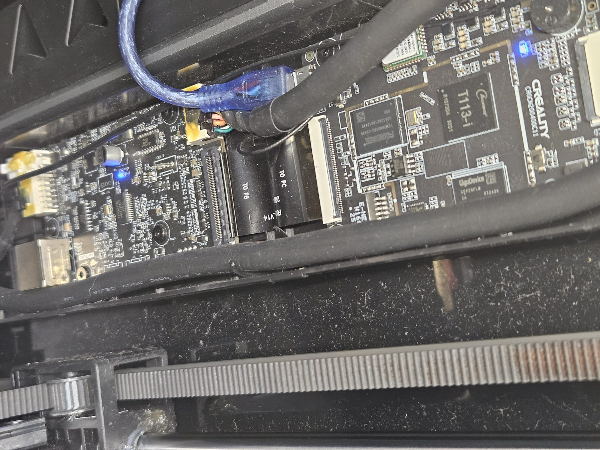
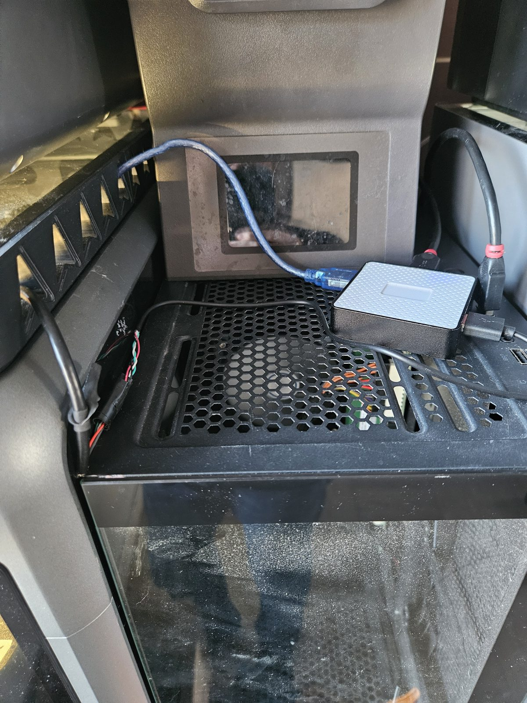

# Running the K2's Klipper on a separate PC (external host)

The K2's own Linux board is an Allwinner T113 (two Cortex-A7 cores). Mainline
Klipper with the open probe, CFS and motor modules uses all of it: klippy sat at
about 108% CPU (more than one core) while printing, and a blocking job such as
`RELOAD_GCODE_MACROS` mid-print starved the step queue ("Timer too close", MCU
shutdown, print lost). This setup moves Klipper and Moonraker to any Linux PC
and leaves the K2 board doing one small job: passing bytes between USB and its
internal serial ports.

On an Intel Celeron N2807 host, klippy used a median 5% (peak 16%) of one core.
The first 7.5-hour print through the link finished with zero "Timer too close",
zero invalid bytes on either MCU, a 1 ms round trip and no relay restarts, while
the same host also printed on a second printer. A later host (i7-11700) also runs
the AI failure watcher ([../tools/ai-detect/](../tools/ai-detect/)) beside it.

## How it works

```
 host PC (Klipper + Moonraker + Mainsail)
   |  one USB cable to the K2's mini-USB port
   v
 K2 board: USB gadget with three serial functions (0525:a4a6)
   gser.0  <->  /dev/ttyS2   main MCU
   gser.1  <->  /dev/ttyS3   nozzle MCU
   gser.2  <->  /dev/ttyS5   X/Y/E motor controllers + CFS (RS485)
           relay.py, 230400 baud, raw
```

- The K2 kernel has the configfs serial gadget (`CONFIG_USB_CONFIGFS_SERIAL=y`).
  `host/k2/start.sh` stops anything on the K2 that holds the UARTs (stock
  Klipper, its linux MCU, a mainline klippy), sets the port to device mode,
  rebuilds the gadget with three serial functions (no ADB) and starts
  `relay.py`, restarted if it ever exits, pinned to CPU1.
- `relay.py` pumps each gadget tty to its UART with every port in raw mode, drops
  anything queued before it starts, gives a blocked side 0.2 s before dropping
  its data (so an unplugged host never stalls the other links), and backs off on
  EIO while the host is away. It logs byte counters every 10 s to
  `/tmp/k2relay.log`.
- On the host, a udev rule binds the generic `usbserial` driver to 0525:a4a6.
  The ports appear as
  `/dev/serial/by-id/usb-Allwinner_Technology_Inc._Tina_ADB_20080411-if0N-port0`,
  and the printer config points `[mcu]`, `[mcu nozzle_mcu]` and
  `[k2_motor_bus]` at if00, if01 and if02 (`host/linux/printer-host-overrides.cfg`).
- When the K2 reboots or the cable is replugged, the same udev rule starts
  `k2-reconnect.service`, which firmware-restarts the host Klipper until it is
  ready. The first restart can land before the boards answer
  ("Failed automated reset of MCU"); the script retries up to four times.

<p>


</p>

*Left: the mini-USB port on the K2's mainboard (the board with the T113-i
processor), with the blue cable in. Right: the host PC
next to the printer. Use a data cable: two of our three were charge-only.*

## Setting it up

K2 side (as root over SSH):

1. Copy `host/k2/relay.py` and `host/k2/start.sh` to `/mnt/UDISK/k2-hostlink/`.
2. Add `host/k2/rc.local.snippet` to `/etc/rc.local`.
3. `mv /mnt/UDISK/.system/boot-mainline /mnt/UDISK/.system/boot-mainline.off`,
   `touch /mnt/UDISK/.system/boot-hostlink`, and disable the K2's own Moonraker
   (`/etc/init.d/moonraker-mainline disable`).
4. Unplug the internal camera: it shares the USB0 controller (`usbc0`) with the
   mini-USB port. The camera is a normal UVC webcam (a108:2240) and works on the
   host PC with a USB-A lead soldered on (see `host/linux/systemd/k2-camera.service`).
5. Point Hark Screen at the host: `moonraker: http://<host>:7126` in harkscreen.cfg.
6. Once, copy the screen from the release you install on the host:
   `harkscreen/harkscreen.py` to `/mnt/UDISK/harkscreen/harkscreen.py` and
   `VERSION` to `/mnt/UDISK/harkscreen/VERSION`, then
   `sh /mnt/UDISK/harkscreen/start.sh`. From v0.4.11 the screen keeps itself
   in step with the host (see Updates).

Host side (Debian/Ubuntu; replace `USER` in the files):

1. Remove ModemManager and brltty (both probe new serial ports), add the user
   to `dialout` (and `video` for the camera).
2. Unzip `k2-openklipper-host.zip` from the newest
   [release](https://github.com/grant0013/K2-OpenKlipper/releases) into
   `~/k2/K2-OpenKlipper` (the release without the K2's ARM C helper; Klipper
   builds its own on first start), and make a venv `~/k2/klippy-env` with
   Klipper's requirements plus numpy.
3. Install Moonraker (KIAUH is fine) and give the K2 its own instance: data dir
   `~/printer_data_k2`, port 7126, `klippy_uds_address` in that data dir. In
   `~/printer_data_k2/config`, make the same two-file layout as on the K2:
   - `k2-openklipper.cfg`: a link to the release's config, so updates reach
     it (`ln -s ~/k2/K2-OpenKlipper/config/mainline_stage2.cfg k2-openklipper.cfg`).
     Don't edit it.
   - `printer-overrides.cfg`: a copy of `host/linux/printer-host-overrides.cfg`
     (replace `USER`), plus your printer's settings underneath (extruder,
     first-layer correction).
   - `printer.cfg`: just `[include k2-openklipper.cfg]` and
     `[include printer-overrides.cfg]`.

   Then copy the K2's CFS material database (`creality/userdata/box` on the
   K2) to `creality_dir`.
4. Install `host/linux/99-k2-gadget.rules`, `reconnect.sh` (to `~/k2/`), the
   units and drop-ins in `host/linux/systemd/`, and the env files.
5. Mainsail on port 4409: `host/linux/nginx-mainsail-k2.conf`.
6. `systemctl enable --now moonraker-k2 klipper-k2`, plug in the cable, reboot
   the K2, and check that the K2 comes back by itself.

## Updating a host

Moonraker's Update Manager installs new releases on the host. Add to the K2
instance's `moonraker.conf`:

```ini
[machine]
provider: systemd_cli      # lets the update restart klipper-k2

[update_manager]

[update_manager k2-openklipper]
type: zip
channel: beta              # stable = full releases only
repo: grant0013/K2-OpenKlipper
path: ~/k2/K2-OpenKlipper
managed_services: klipper
```

K2 OpenKlipper then shows in Mainsail's Update Manager with its version, and
**Update** downloads the release's `k2-openklipper-host.zip`, replaces
`~/k2/K2-OpenKlipper` and restarts Klipper (it builds its C helper again, a
few seconds). `printer-overrides.cfg` is untouched, so your settings carry
over. Moonraker refuses while printing; don't update with a print paused.

`channel: beta` offers every published release (all releases so far are
pre-releases). Its newest-release lookup needs Moonraker's
`releases?per_page=10` fix (`system/moonraker-compat/update_manager.py` has it
for the K2): stock Moonraker v0.11 reads only the first release GitHub lists,
which is the one marked Latest. On a host, make the same change in
`_fetch_github_version` in `moonraker/components/update_manager/net_deploy.py`
(take the most recently published of `releases?per_page=10`).

The touchscreen's and Mainsail's own **Update** dialog (`OKL_UPDATE`)
installs onto the K2 board, so the host overrides switch it off
(`[hark_update]`). The K2 side (`host/k2/`) only needs copying again when a
release says it changed.

The touchscreen program runs on the K2 board, which a host update does not
touch. From v0.4.11 it updates itself: while the printer is idle it compares
the version the host's Klipper reports with its own, downloads that release's
`harkscreen.py` from GitHub (the K2 board needs Internet access), checks it,
keeps the old copy as `harkscreen.py.prev` and restarts. If the new copy fails
to start, the old one comes back and that release is not fetched again
(`/mnt/UDISK/harkscreen/.bad_version`). Log: `/tmp/harkscreen.log`. Before
v0.4.11 the screen stayed on whatever was copied at setup.

## Things that bit us

- **Charge-only cables.** Two of three mini-USB cables had no data lines.
  `dmesg` on the host shows nothing at all with those.
- **K2 mains off with the USB plugged in.** The host's USB 5 V back-powers the
  K2 board, which boot-loops every ~11 s (the screen flips between the
  Creality and Hark logos; the host sees 18d1:d002 appear and vanish). Switch
  the K2 on at the mains.
- **Interface order.** The interface number follows the order the functions are
  linked, so the boot script always links gser.0, 1, 2 in order. With the
  wrong mapping, Klipper sends MCU identify packets to the motor bus. Never let
  anything but `[k2_motor_bus]` open if02.
- **Raw mode on every port.** A gadget tty echoes by default; an MCU stream
  echoed back into itself corrupts the protocol.
- **ADB.** FunctionFS will not rebind without adbd re-arming it, so the gadget
  drops ADB; SSH covers everything it did.
- **Host BIOS.** A PC that stops at "Press F1 to continue" after a power cut
  never comes back unattended: set the BIOS to continue on warnings and to power
  on after AC loss.
- **CFS right after a K2 restart.** The first print after the boot loop above
  stopped on "CFS slot C does not report filament"; minutes later the CFS
  reported all slots and the retry printed. Give the CFS a minute after a K2
  restart.

## Going back to Klipper on the K2

```sh
rm /mnt/UDISK/.system/boot-hostlink
mv /mnt/UDISK/.system/boot-mainline.off /mnt/UDISK/.system/boot-mainline
/etc/init.d/moonraker-mainline enable
# set harkscreen.cfg back to moonraker: http://127.0.0.1:7126
reboot
```
