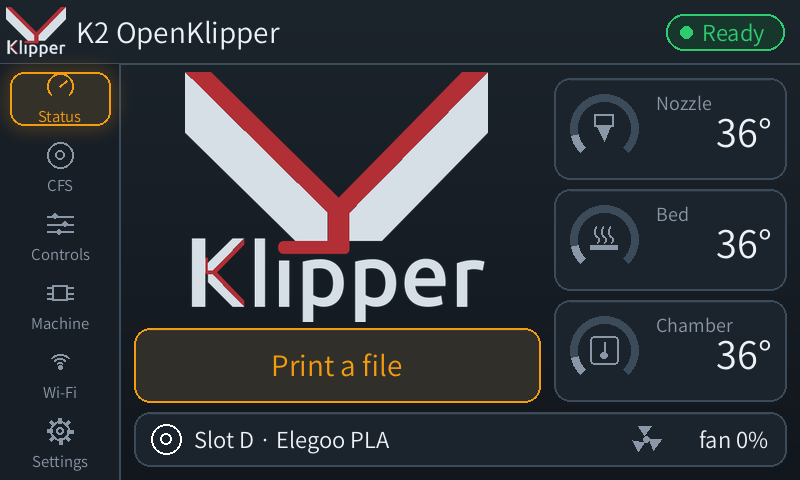
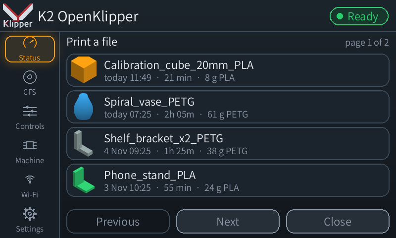
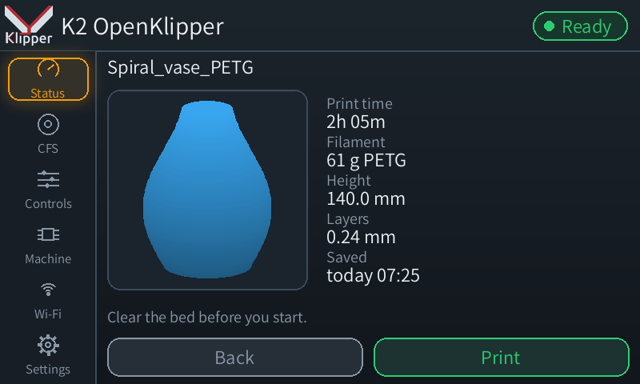
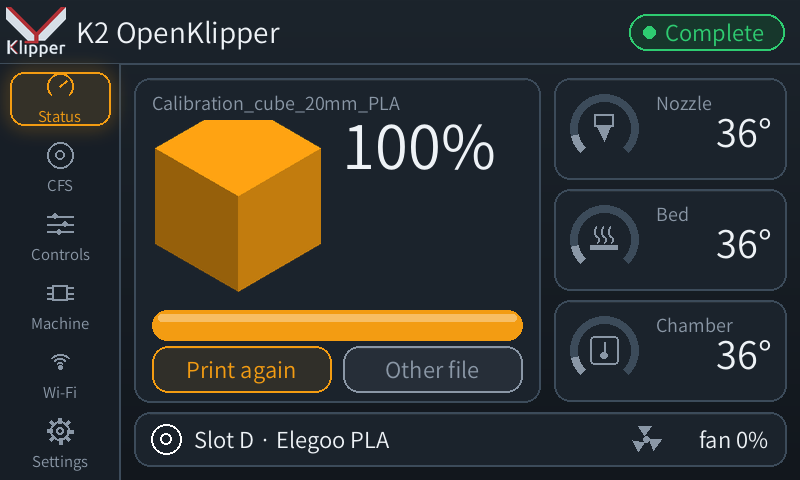

# Touchscreen (Hark Screen) and camera

With Creality's `master-server` disabled, the stock touchscreen has nothing to
talk to. `harkscreen/harkscreen.py` is a replacement UI that draws straight to
the framebuffer and talks to Moonraker.

## Hark Screen

- Landscape layout (the panel is portrait, 480x800; the UI rotates 90°).
- Pages: status (progress, temperatures, ETA from the slicer's M73), CFS
  slots, controls, machine, Wi-Fi.
- **Print a file** (Status page, when idle): the print files newest first,
  four to a page with the slicer's thumbnail, age, print time and filament;
  tap one for its preview and details, then **Print** to start it. After a
  print, **Print again** opens the same file's details (clear the bed
  first) and **Other file** the list. Starting goes through Moonraker
  (`/printer/print/start`); a refusal is shown under the preview.

  | | |
  | --- | --- |
  |  |  |
  |  |  |
- CFS slot sheet: edit the filament record, Load & purge, Purge, Unload, and
  **Calibrate PA** for the loaded slot.
- Wi-Fi selection with an on-screen keyboard, through `wpa_supplicant`'s
  control socket, with rollback if the new network fails.
- Themeable: `harkscreen.cfg` sets the name, logo, colours, font, page order,
  sleep and timezone. Changes are picked up within a second.
- Light on the K2's 2-core CPU: redraws only on change, partial blits for
  animations, pinned to CPU0 at nice 10. About 6% CPU when idle.

`install.sh` sets it up: it copies `harkscreen/` to `/mnt/UDISK/harkscreen/`
and puts `harkscreen.cfg` (from the `.example`) and `klipper-logo.png` in the
Klipper config folder. The switch script starts it (`start.sh`);
`switch-to-stock.sh` stops it.

The default look is Klipper's logo and colours. To change the name, logo,
colours, font or pages, see **[customising the screen](SCREEN-CUSTOMISE.md)**.
`harkscreen/themes/hark-tech.cfg` is a second example theme.

`tools/bootanim/make_bootanim.py` builds a custom boot animation for
`/usr/res/boot-play`. Back up the stock one first.

## Camera (harkcam)

The chamber camera is a USB UVC device (`/dev/video0`, MJPEG/YUYV/H264).
Creality serves it through its own WebRTC apps, which Mainsail cannot use.
`harkcam/harkcam.py` stops those and serves the camera's own MJPEG stream
with no re-encoding:

- `ffmpeg -f v4l2 -input_format mjpeg -video_size 1280x720 -framerate 10
  -i /dev/video0 -c:v copy -f mjpeg pipe:1`, split into frames
- `http://<printer>:8080/?action=stream` and `/?action=snapshot`, the same
  URLs as mjpg-streamer, so Mainsail, Obico-style AI detectors and the like
  work as-is
- about 5% CPU

The printer's WiFi is the limit, not the CPU. A 720p frame is about 85 KB
with the chamber light on, so 15 fps to one viewer was about 1.3 MB/s and
pushed ping to about 1 s; with two viewers the network stopped answering,
and a print stopped with `Stepper too far in past` (issue #4). So:

- **10 fps shared by all viewers.** Streams and snapshots draw on one frame
  budget, so two open tabs get 5 fps each and the data sent stays the same.
- **At most 2 streams.** A new stream closes the oldest, so switching to a
  fullscreen camera page never comes up blank.
- `printer_data_mainline/config/harkcam.cfg` (editable in Mainsail) sets
  `size` (1280x720, 800x600, 640x480), `fps` (1 to 15) and `max_streams`
  (1 to 4). Run `sh /mnt/UDISK/harkcam/start.sh` or reboot after a change.
  `fps: 5` or `size: 640x480` leaves more room on a weak WiFi signal.

### WebRTC mode (H.264, much lighter on WiFi) - in testing

Creality's own camera path (`cam_app` + `webrtc_local` on :8000) has the
camera compress to H.264 and sends it over WebRTC: about 51 KB/s per viewer
against 800+ KB/s for MJPEG, with ping unaffected by 3 viewers (measured by
nur00, issue #4). `mode: webrtc` in `harkcam.cfg` switches to it:

1. In `harkcam.cfg` (Mainsail: Machine > config files) set `mode: webrtc`,
   then run `sh /mnt/UDISK/harkcam/start.sh` over SSH, or reboot.
2. In Mainsail: Settings > Webcams > K2 Chamber: **Service** "WebRTC
   (MediaMTX)", **URL Stream** `/webcam/`. Fluidd: the same camera type and
   URL.
3. `http://<printer>/webcam/` is a test page that plays the stream on its
   own.

How it works: `start.sh` starts Creality's `cam_app` and `webrtc_local`
through Creality's own `/usr/bin/auto_uvc.sh` (with the K2's crop
settings), and `harkcam.py` answers Mainsail's WHEP calls on :8080 by
passing the browser's offer to `webrtc_local` in its own base64 JSON
form. `webrtc_local` sends video only, so the audio Mainsail asks for is
refused in the answer; it takes no trickled ICE candidates, and learns the
browser's address from its connection checks instead.

The camera sends one format at a time, so in this mode there is **no MJPEG
stream or snapshot**: time-lapse, the AI watcher and anything reading
`/webcam/?action=snapshot` need `mode: mjpeg` (the default). `mode: mjpeg`
and `start.sh` again switch back.

nginx proxy for the Mainsail server block:

```nginx
location /webcam/ {
    proxy_pass http://127.0.0.1:8080/;
    proxy_buffering off;
    proxy_read_timeout 3600s;
}
```

Register the camera in Moonraker (`POST /server/webcams/item` on Creality's
older Moonraker). Mainsail 2.18 hides webcams without an `enabled` field,
which that Moonraker does not send; `system/moonraker-webcam-defaults.patch`
adds the defaults.
