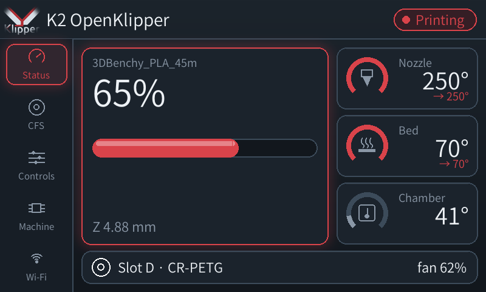
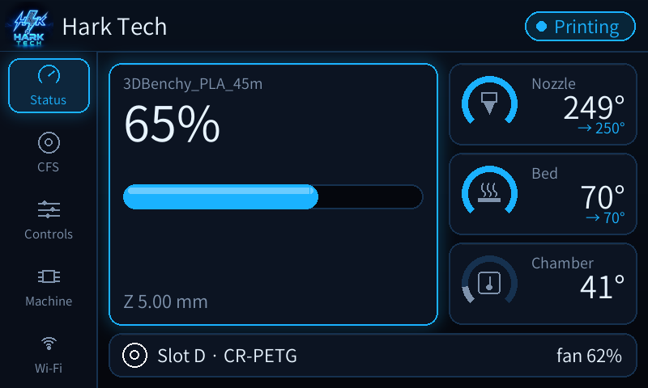
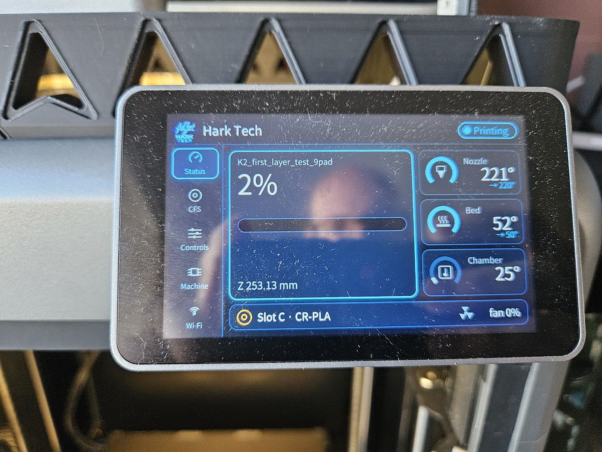

# Customising the touchscreen (Hark Screen)

The touchscreen app reads one settings file, `harkscreen.cfg`, in the Klipper
config folder. Change it, save, and the screen updates within a second. No
restart, no SSH.

Out of the box it uses the Klipper logo and Klipper's colours:



The same app with the Hark Tech theme (`harkscreen/themes/hark-tech.cfg`):



On the printer, the default Klipper theme and the Hark Tech theme:

<p>


</p>

## Edit it in Mainsail

1. Open Mainsail (`http://PRINTER-IP:4409`), then **Machine** in the left menu.
2. In the config file list, click **harkscreen.cfg**.
3. Change what you like (below), then **Save & close**. Watch the screen
   change.

If something looks wrong, put the line back the way it was and save again.
A missing or misspelt setting falls back to the default, so a typo will not
stop the screen.

## Your name and logo

```ini
[brand]
name: Smith's K2
logo: my-logo.png
idle_logo: yes
```

- **name**: the text in the header, top left.
- **logo**: a PNG file in the same folder as `harkscreen.cfg`, or a full path.
  To add yours, in Mainsail's **Machine** page use the **upload** button (the
  arrow icon above the file list) and pick your PNG, then put its file name
  here.
  - A square-ish image around 400 to 600 pixels works best. A transparent
    background looks best; the app also softens the edges of square logos so
    they sit on any background colour.
  - It shows small (60 px) in the header and large on the Status page when
    nothing is printing.
- **idle_logo**: `yes` shows the big logo on the Status page when idle, `no`
  leaves that space empty.

## Colours

```ini
[theme]
background: #12171d
panel: #1b232c
panel_edge: #3c4b5a
accent: #d9434a
text: #eef2f6
muted: #8a97a6
ok: #2ecc71
warn: #f5a623
error: #ff6b6b
```

Colours are `#RRGGBB` (any colour picker shows this, for example by searching
"colour picker" in a web browser).

| Setting | Where you see it |
| --- | --- |
| `background` | Behind everything |
| `panel` | The cards and buttons |
| `panel_edge` | Card and button outlines, the empty part of gauges |
| `accent` | Your highlight colour: the selected page, progress bar, temperature rings, the status pill |
| `text` | Main text |
| `muted` | Labels and secondary text |
| `ok` | Good news, e.g. "CFS online", a saved result |
| `warn` | Pause button, warnings |
| `error` | Cancel button, errors |

Tips: keep `text` light on a dark `background` (or dark on light) so it stays
readable from across the room, and keep `accent` different from `error` if you
want errors to stand out.

## Font and size

```ini
font: /etc/sysConfig/defData/SourceHanSansCN-Normal.otf
font_scale: 1.0
```

- **font**: any TTF or OTF file, as a **full path**. The default is the font
  Creality ships on the printer. To use your own, upload the `.ttf` to the
  config folder in Mainsail and write
  `font: /mnt/UDISK/printer_data_mainline/config/YourFont.ttf`.
- **font_scale**: `1.2` makes all text 20% bigger, `0.9` smaller. Large values
  can make long names run off a card.

## Pages, sleep and the rest

```ini
[screen]
pages: status,cfs,controls,machine,wifi
sleep_after: 600
timezone: uk
rotate: 90
```

- **pages**: which pages appear in the side bar, in order. Leave one out to
  hide it, e.g. `status,cfs,controls` hides Machine and Wi-Fi.
- **sleep_after**: seconds without a touch before the screen turns off (`0` =
  never). It never sleeps while printing, and a tap wakes it.
- **timezone**: for the "done about" time on the Status page: `uk` (GMT/BST)
  or hours from UTC, e.g. `+2`.
- **rotate**: `90` is the K2's landscape mounting; leave it.
- **touch_*** settings: only if taps land in the wrong place.
- **moonraker**: where the screen gets its data. Leave it as
  `http://127.0.0.1:7126`, unless Klipper runs on a separate PC
  ([external host](EXTERNAL-HOST.md)), then use `http://<that PC>:7126`.

## Ready-made themes

- `harkscreen/harkscreen.cfg.example`: the default Klipper theme.
- `harkscreen/themes/hark-tech.cfg` with `hark-tech-logo.png`: the Hark Tech
  theme from the developer's printer.

To switch, copy the theme's settings into your `harkscreen.cfg` (or replace the
file) and upload its logo next to it.

To go back to the default at any time, replace the contents of
`harkscreen.cfg` with `harkscreen/harkscreen.cfg.example` from this repository
and make sure `klipper-logo.png` is in the config folder.

Made a theme you like? Share it: add `harkscreen/themes/<name>.cfg` and its
logo in a pull request.

## Boot animation (optional, advanced)

The animation shown while the printer boots is Creality's, and the installer
leaves it alone. `tools/bootanim/make_bootanim.py` builds one from your logo:

```sh
python3 make_bootanim.py my-logo.png out/ [font.ttf] [background #RRGGBB] [accent #RRGGBB]
```

Replacing `/usr/res/boot-play` is a change to the printer's system files:
back up the stock folder first, and know that `uninstall.sh` does not restore
it.
