# K2 OpenKlipper Touchscreen

A fast, responsive native LVGL interface for [K2 OpenKlipper](https://github.com/grant0013/K2-OpenKlipper).

Printer identity, heater and travel limits, homing state and available features
come from the printer configuration. The interface is currently in English.
Screenshots show the native application with example data.

## Performance and responsiveness

In the recorded comparison, the native screen had the lowest screen CPU usage
and fastest tap response both idle and during printing. Without taps, the screen
and backend together used 7.4% of one core while idle and 9.5% while printing.

Moonraker is measured separately: native used more CPU during idle navigation
and less during printing than HarkScreen. See [performance and responsiveness](PERFORMANCE.md)
for the tables and test conditions.

## Installation

Use a K2 OpenKlipper version that includes this interface and follow that
version's installation instructions. Its installer supplies the matching
precompiled screen, backend and startup scripts; no compilation on the printer
is needed. A touchscreen-only update restarts its two processes, without
restarting Klipper.

## Home

- Idle Home shows matching printer illustrations with or without CFS.
- Tap temperature tiles to set targets; open files, filament controls or fans,
  and switch the light.
- CFS spool colours follow the reported slot data, independently of the UI
  highlight colour. Colour changes leave the illustration's size and position fixed.

| Idle with CFS | Idle without CFS |
| --- | --- |
|  |  |

| Live slot colours | Empty CFS |
| --- | --- |
| 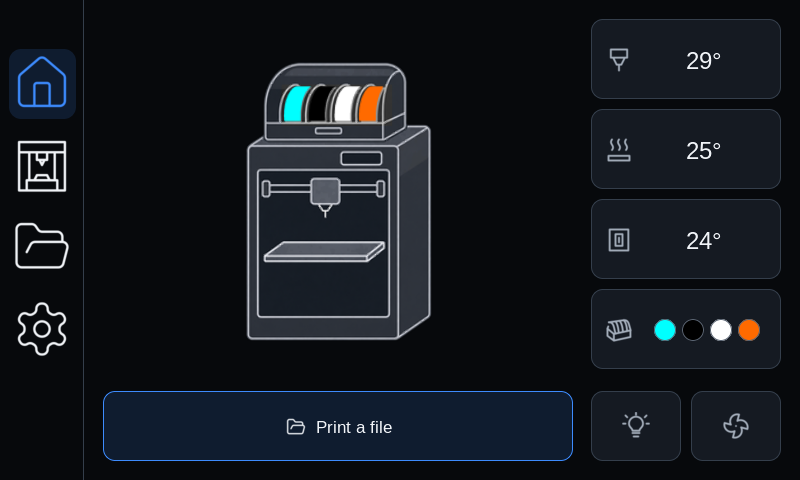 | 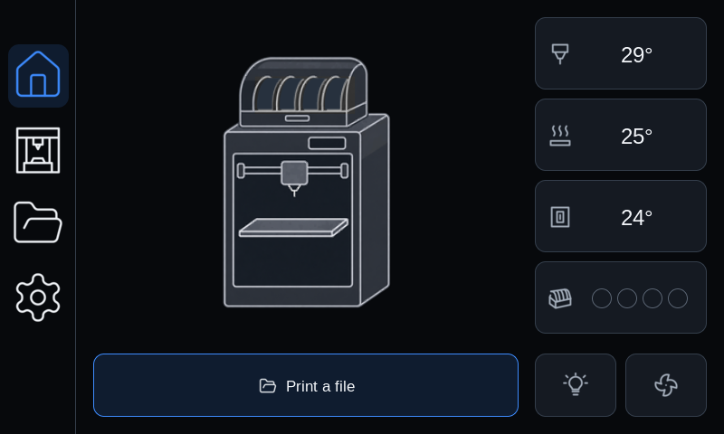 |

- Spools look neutral/unfilled until data arrives, or when a slot is empty or
  its unit is offline. A present filament with an unknown colour is gray.
- With several units, the illustration and Home shortcut show the unit loading
  or unloading, otherwise the feeding unit, or the first available unit.
- Loading/unloading keeps the colours while filament remains in the CFS.
  The shortcut and sidebar show progress; the illustrated spools stay still.

### During a print

- The selected preview appears with **Starting print…**, then Klipper supplies
  preparation and printing status. Unknown time and layer values stay hidden.
- View the preview, remaining hours/minutes, progress and `Layer current / total`.
  Full filenames stay in file details.
- Pause, stop, or open the plate view to skip failed objects.
- Tap the status text or history icon for **Status history**. Long messages use
  up to two lines, then an ellipsis.
- CFS swatches and the nozzle marker identify available and feeding filament.
  Light and fan shortcuts remain available; the bulb has rays when on and is crossed when off.

| Starting a print | Printing |
| --- | --- |
| 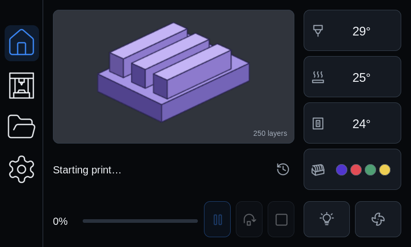 |  |

| Heating toward targets | Long status message |
| --- | --- |
|  | 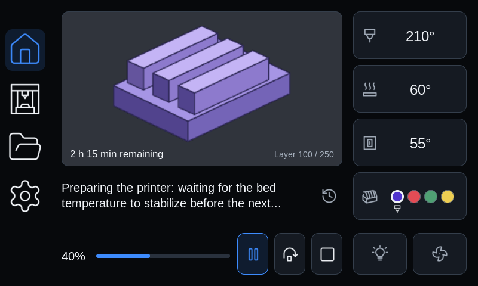 |

| Long time and layer counts | Dark model preview |
| --- | --- |
| 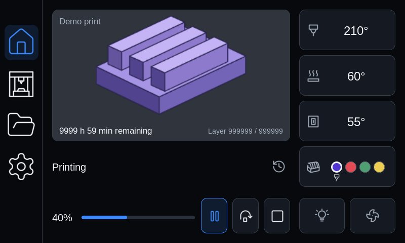 |  |

### Temperatures

- Choose a preset or tap the target for numeric entry. Limits follow configuration.
- Tiles show current → target while heating or cooling toward it, then just the
  current temperature near the target. Display rounding avoids flicker.
- Targets stay editable while heating, subject to calibration and filament locks.

| Nozzle target | Numeric entry |
| --- | --- |
| 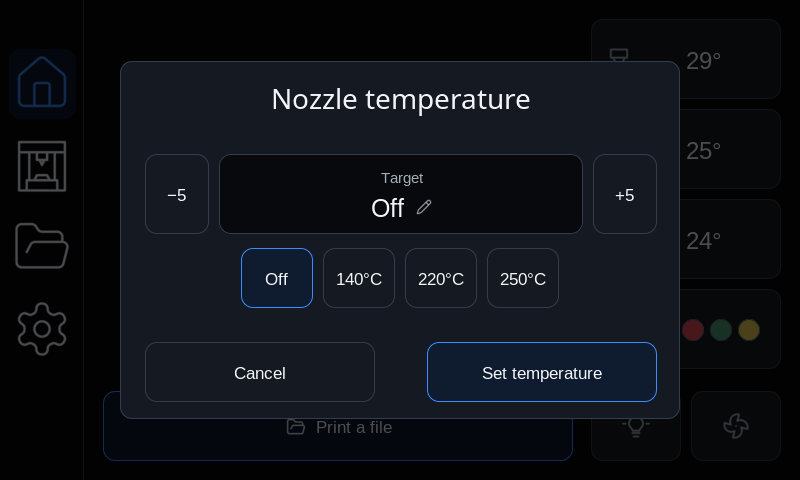 | 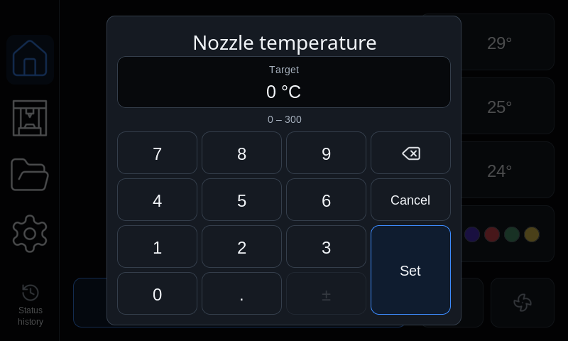 |

| Bed target | Chamber target |
| --- | --- |
| 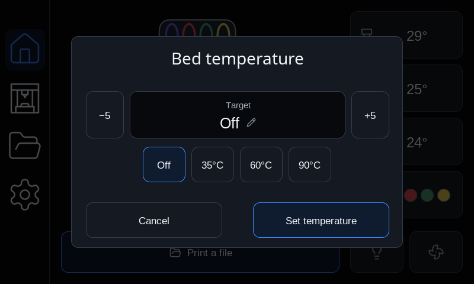 | 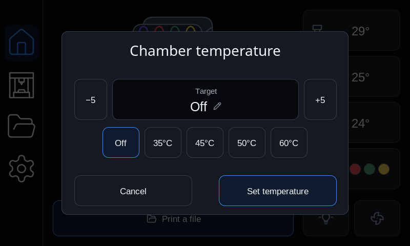 |

### Activity, messages and recovery

- Routine work uses a sidebar spinner and short caption. Keep navigating while
  conflicting controls are disabled; progress is not repeated on its own page.
- The badge disappears when finished. Tap it for history, or open
  **Settings → System → Help & logs** when idle.
- Errors open a dialog. Calibration blocks choosing another print; homing alone
  still allows browsing files. Printing by itself does not create an activity badge.

| Homing | Reading a file |
| --- | --- |
| 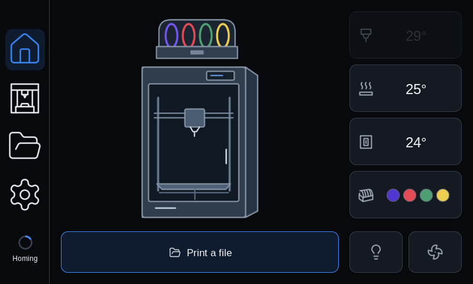 |  |

| Calibration in progress | Printer error |
| --- | --- |
| 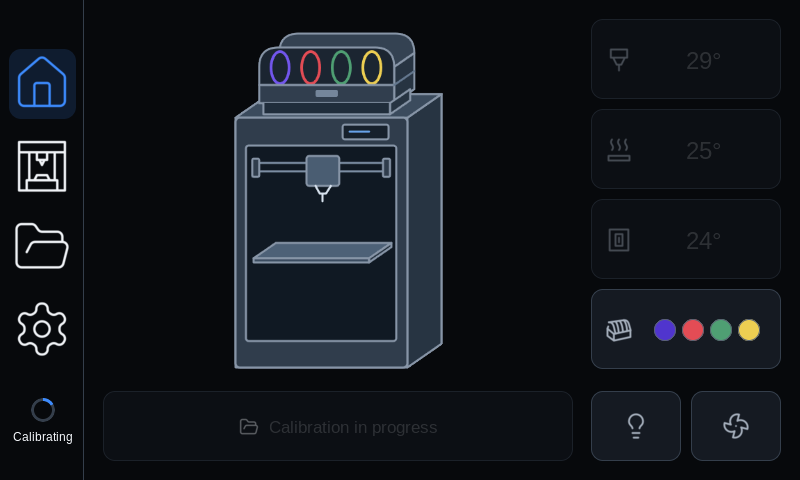 |  |

| Notice | Status history |
| --- | --- |
| 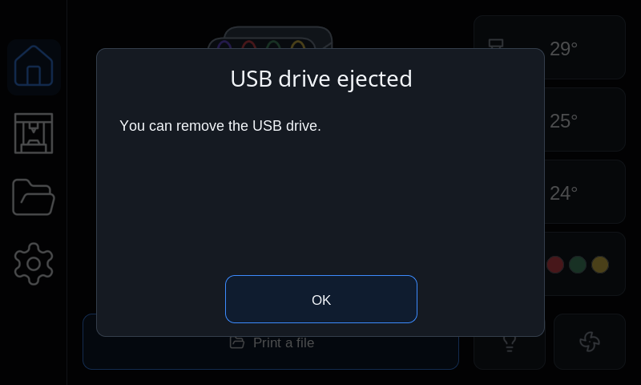 | 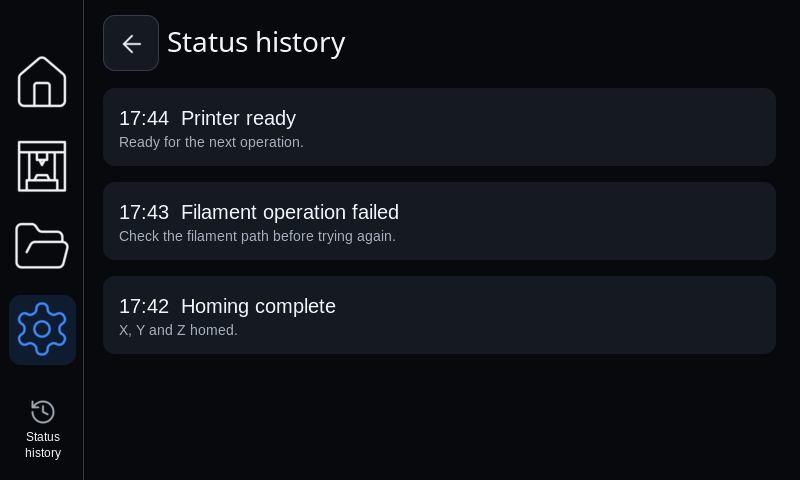 |

| Recent errors | Printer startup |
| --- | --- |
| 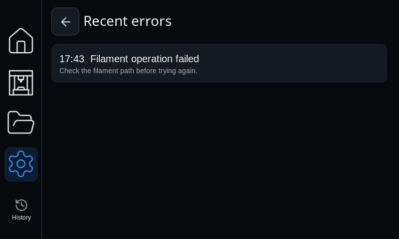 | 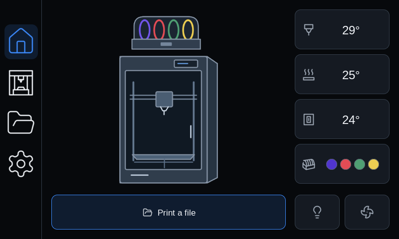 |

Startup waits for printer control and initial state. After a requested restart,
the waiting screen includes motor initialization before restoring the previous
page. Lost Klipper/MCU connections offer recovery actions; a lost local screen
service has its own reconnecting screen. The previous page returns after reconnection.

| Printer connection lost | MCU or Klipper shutdown |
| --- | --- |
|  |  |

| Screen service unavailable | Restarting firmware |
| --- | --- |
|  | 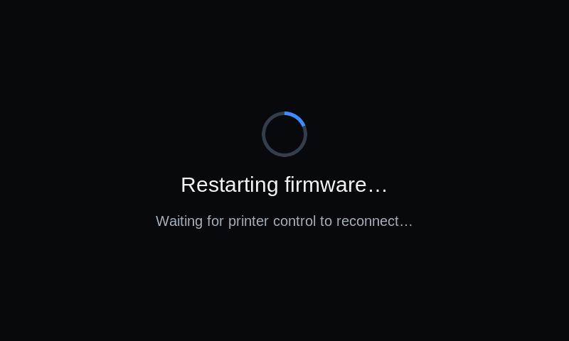 |

## Printer controls

### Move

- Home, jog X/Y/Z, or tap a coordinate to enter a destination within travel limits.
- Live coordinates show Klipper's estimated position. A smaller destination
  appears underneath during movement; the main value stays in place.
- Unhomed axes and conflicting actions are disabled. During printing, Move shows
  an explanation instead of movement controls; the bed mesh viewer remains accessible.
- Extrude/retract when the nozzle is hot enough. Unlocking motors requires
  confirmation because the bed may move under its own weight.

| Movement | Live coordinates |
| --- | --- |
| 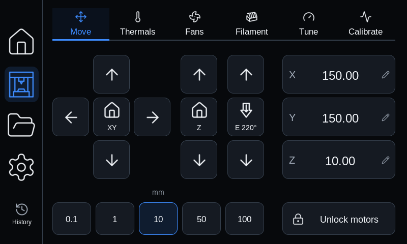 | 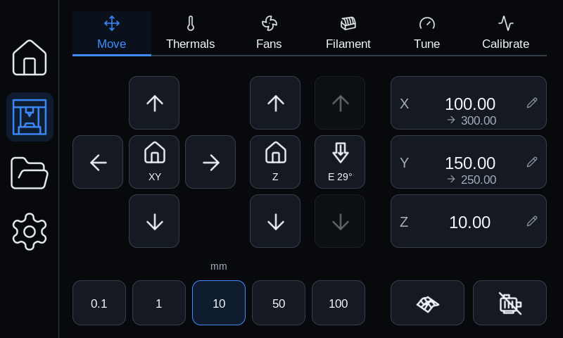 |

### Bed mesh

- Open from Move. Drag to rotate the surface; the X/Y/Z markers follow the view.
  X increases left to right, Y front to back, and Z upward. A Front marker follows
  the physical front edge, with its text angled along that edge. Rotation stays
  upright. Reset the view with one tap.
- Review the profile name, grid, minimum/maximum height and Z range. Saved
  profiles form a scrollable list: tap a single-line name to preview saved points
  without loading a mesh. Each row has borderless Load and Delete icons; a check
  marks the loaded profile. Rename the displayed profile using the pencil beside
  its title; an unloaded preview also has a Load icon beside the pencil. Long
  names stay still and end with an ellipsis. Hold a name to scroll it; release
  to restore the truncated view. Profile actions preserve the list position.
  Renaming an unloaded profile restores the previously loaded profile. Renaming
  another profile is blocked while the current mesh is unsaved.
- The list has no header or Save action and shows three full profiles at once.
  Probe the bed when idle. During printing, viewing and rotation
  remain available, while probing and profile changes are disabled.
- Probing replaces the old surface with progress. With no active mesh, load a
  saved profile or probe a new one; an empty viewer explains when probing must wait.

| Bed mesh | Probing in progress |
| --- | --- |
| 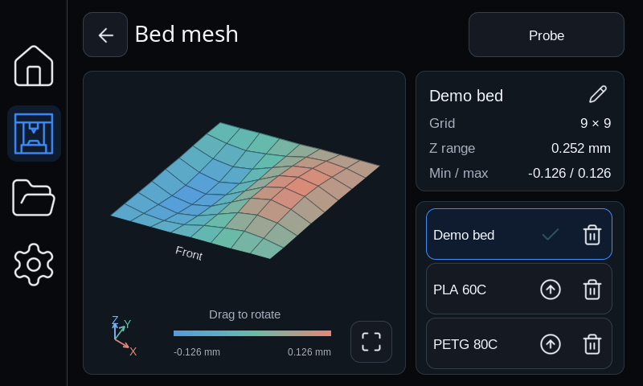 | 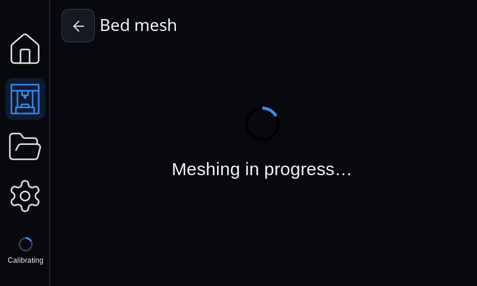 |

| Selected saved mesh, not loaded | Front marker follows rotation |
| --- | --- |
| 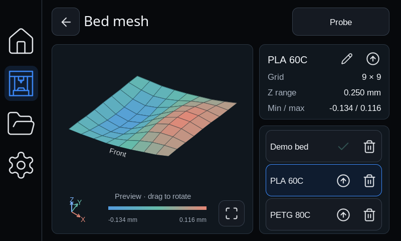 | 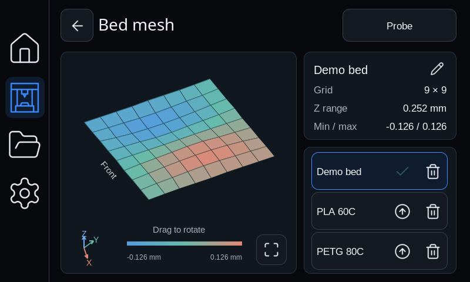 |

| Rename the displayed mesh | Prepare the bed before probing |
| --- | --- |
| 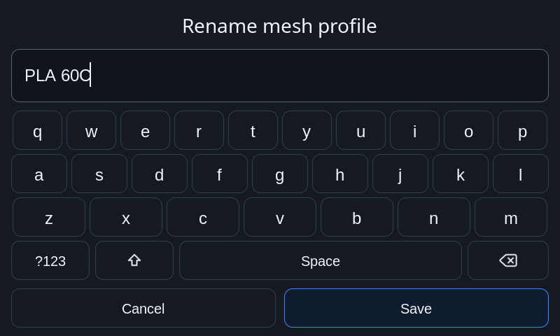 | 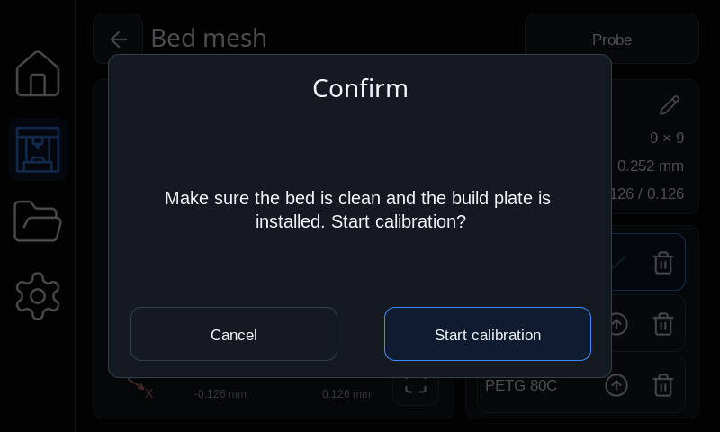 |

| Long name at rest | Hold the name to read it |
| --- | --- |
| 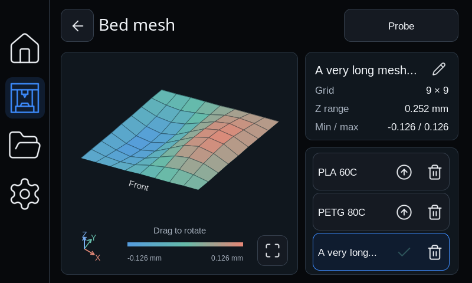 |  |

| Saved profiles, none active | No measured or saved mesh |
| --- | --- |
| 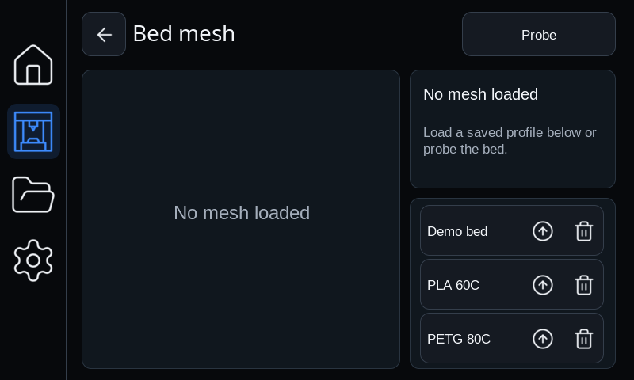 | 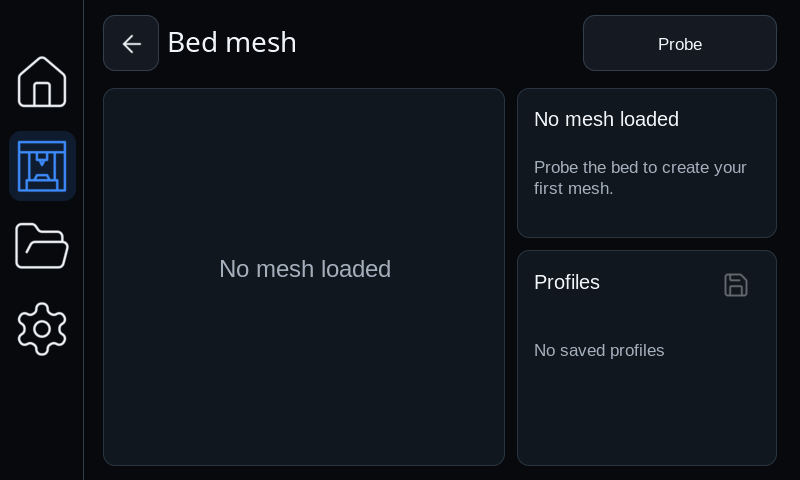 |

| Viewing during printing | No mesh during printing |
| --- | --- |
| 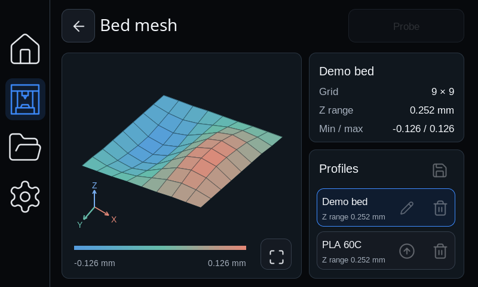 | 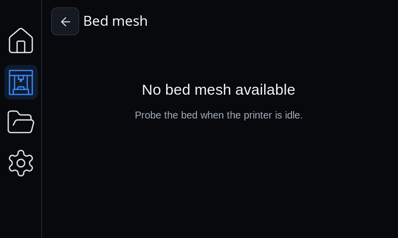 |

| Flat mesh example | Delete confirmation |
| --- | --- |
| 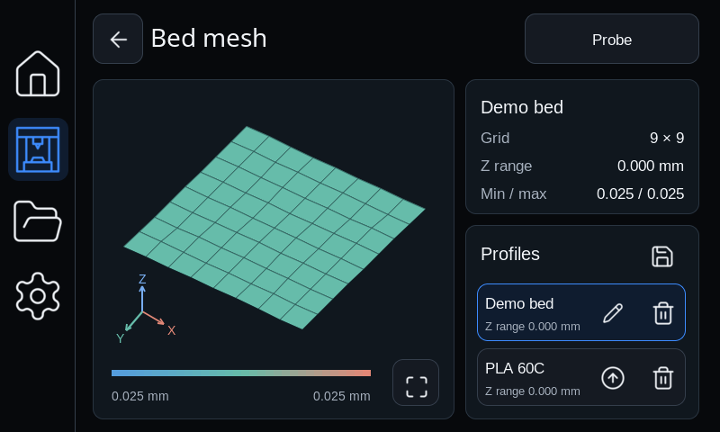 | 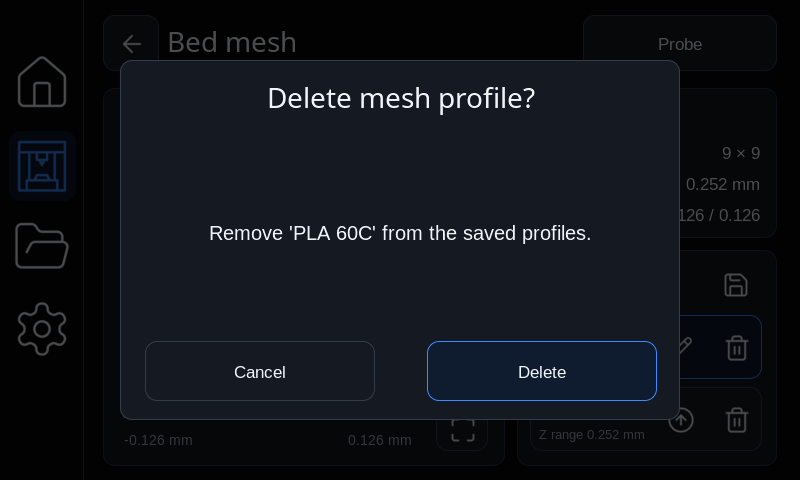 |

### Thermals and fans

- Thermals groups nozzle, bed and chamber targets in columns.
  **Turn heaters off** is available when idle.
- Sliders control part cooling, side cooling and chamber exhaust where supported.
  Hotend cooling stays under firmware control.

| Thermals | Fans |
| --- | --- |
|  |  |

### Filament and CFS

- Select a spool to edit its material, colour and nozzle temperature, or Load/Unload.
  The accent border marks selection; the nozzle marker identifies feeding filament.
- Material filters shorten the list. Temperature and humidity sit below the spools.
- One CFS needs no selector. For two to four reported units, selectors share the
  available width; the spool holder remains separate.
- Without CFS, edit the spool-holder card and feed filament manually. Load/Unload
  buttons are hidden. Set its material and colour before mapping it to a print.
- **Reset** clears a spool's saved details after confirmation; it does not unload filament.

| One CFS | No CFS |
| --- | --- |
|  |  |

| Two CFS units | Three CFS units |
| --- | --- |
|  | 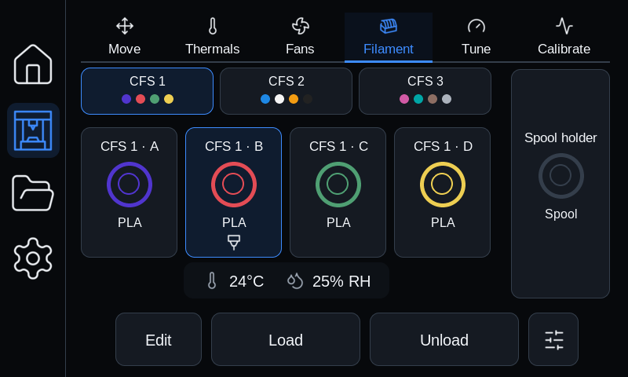 |

| Four CFS units | Filament editor |
| --- | --- |
|  |  |

| Material filters | Colour picker |
| --- | --- |
| 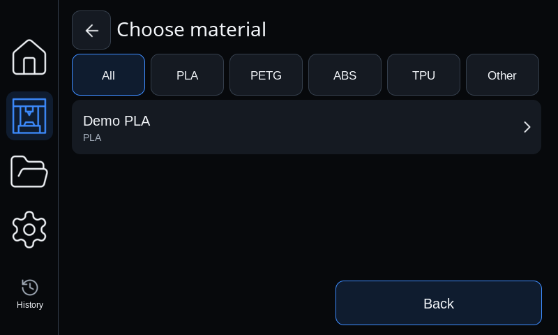 |  |

| Loading filament | Unloading filament |
| --- | --- |
|  |  |

| CFS preferences | Automatic refill sequence |
| --- | --- |
|  |  |

| Spool-holder editor | Reset spool holder |
| --- | --- |
| 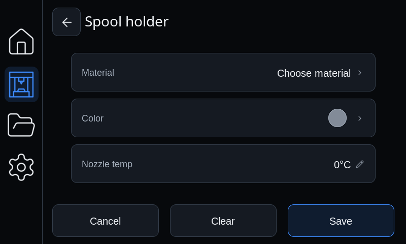 |  |

Removing CFS filament clears the displayed details and marks the slot empty.
Insertion opens **Filament changed**; **OK** selects that slot for entering its
material, colour and nozzle temperature. These events require the matching
Klipper driver from the complete installation, not just a new screen binary.

| Reset a CFS slot | Slot emptied on removal |
| --- | --- |
| 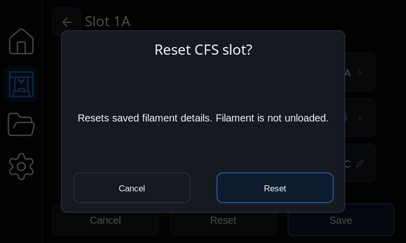 |  |

| Insertion notice | Slot selected after OK |
| --- | --- |
| 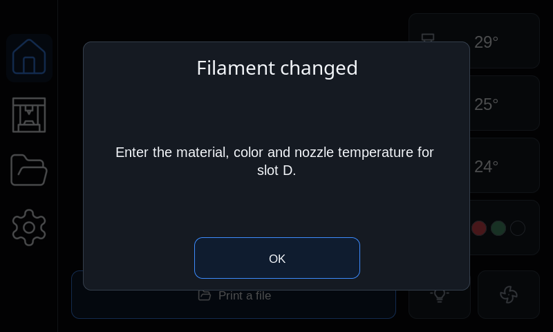 |  |

Automatic refill uses loaded slots with matching material and colour; its
sequence page shows matching sources. Automatic RFID reading is not exposed
as a setting in this interface.

**Hardware limitation:** the current OpenKlipper CFS driver operates one
configured unit. Multi-unit screenshots demonstrate the UI; additional hardware
support needs backend work. One unit's environmental readings are not reused for others.

### Tune and calibrate

- Adjust print speed and flow with steps or numeric entry, up to 200%.
- Change Z offset for the current print, by at most 0.1 mm per adjustment.
- Tuning values refresh when the page opens. If they take longer to arrive, the
  shared loading indicator appears before the adjustment controls.
- Calibrate with homing, Z tilt, full bed mesh, input shaping, belt tension and
  cutter calibration where supported. Z tilt requests homing if needed.
- Save pending configuration changes with confirmation. During printing,
  calibration controls are replaced by an explanation.

| Print tuning | Calibration |
| --- | --- |
|  |  |

| Save configuration | Calibration unavailable during printing |
| --- | --- |
|  |  |

| Waiting for current tuning values |
| --- |
| 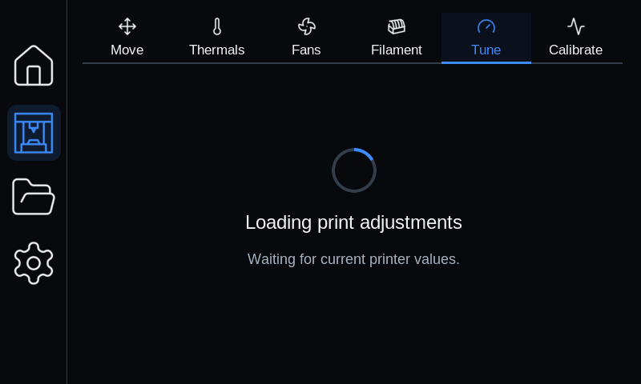 |

### Filament activity

- Loading/unloading follows the affected spool, including print tool changes.
- Home shows a ring around its colour and a sidebar caption. Filament shows the
  operation on its spool tile, without repeating it in the sidebar.
- Keep browsing while conflicting actions are disabled. Indicators clear when
  finished; failures use the normal error dialog.

| Loading a spool | Unloading a spool |
| --- | --- |
| 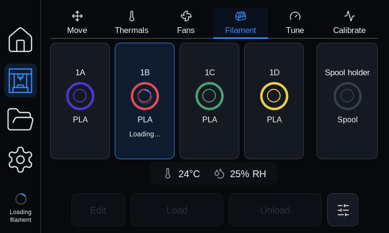 | 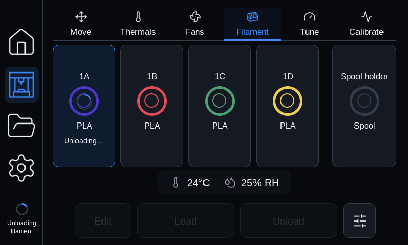 |

| Home sidebar and colour ring | Activity across CFS units |
| --- | --- |
| 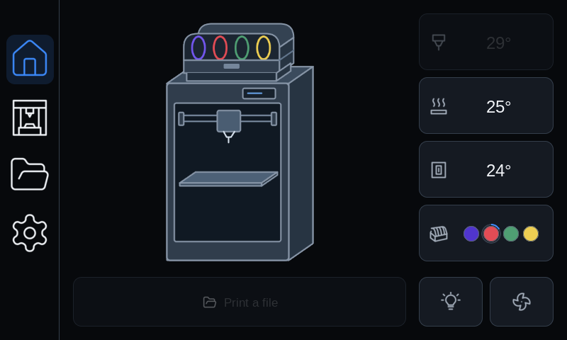 | 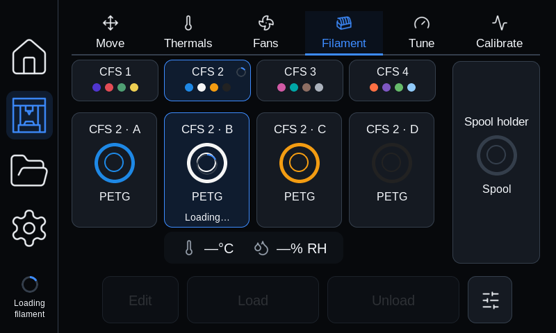 |

## Files and starting a print

1. Browse files with thumbnails or a fallback icon. Refresh keeps the list visible
   and reports progress in the sidebar.
2. Review the preview and details; select **Calibrate before printing** if available.
3. Map each file filament to a loaded, configured source, then **Start print**.
   Lists scroll by touch. Incompatible materials are disabled; colours may differ.

A new preview shows progress while loading, then a file icon if no image exists.
Home uses the same fallback during printing. Embedded Creality/Orca thumbnails
and material metadata are read when Moonraker has not extracted them; filenames
are not used to guess material.

- Trash icons open a filename-specific **Cancel / OK** dialog. Other files can be
  deleted during printing; the active or pending print file is protected.
- Select failed objects on the plate view and confirm skipping them.

| Files | Background refresh |
| --- | --- |
|  |  |

| File review | Filament mapping |
| --- | --- |
| 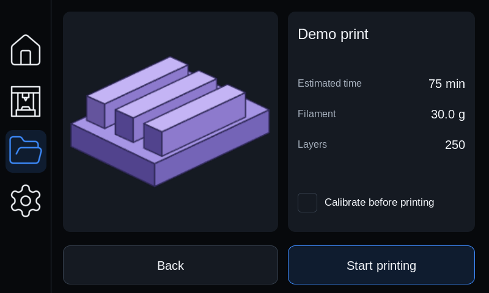 |  |

| Material-aware source picker | Skip print objects |
| --- | --- |
|  |  |

| Delete confirmation | Stop-print confirmation |
| --- | --- |
|  |  |

| Reading a preview | No embedded preview |
| --- | --- |
| 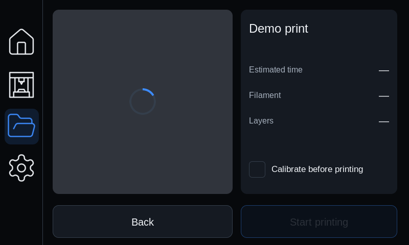 |  |

## Settings

| General settings | Network settings |
| --- | --- |
| 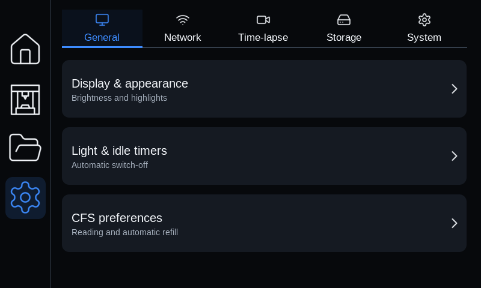 | 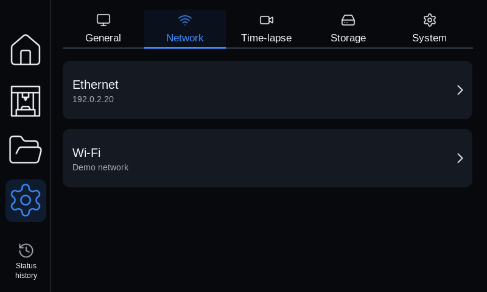 |

### General

- Change brightness and the highlight colour; open CFS refill preferences when connected.
- Set screen sleep, light-off and idle timers. Printing, operations and urgent
  messages keep the screen awake. The first touch wakes it without activating a control.

| Display and appearance | Screen, light and idle timers |
| --- | --- |
|  | 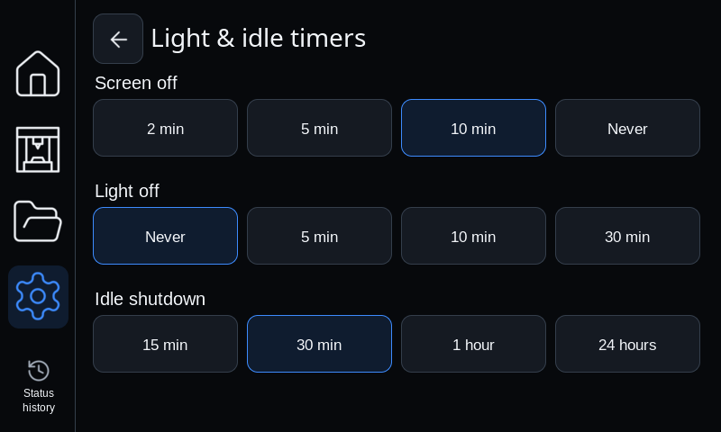 |

### Network

- View Ethernet/Wi-Fi details, scan networks and connect with a password.
- A blinking caret marks password entry; the eye icon shows or hides it.
  Shift is one-shot, with double-tap for capitals.
- Scanning and connecting show progress, followed by success or failure feedback.

| Ethernet | Wi-Fi details |
| --- | --- |
|  | 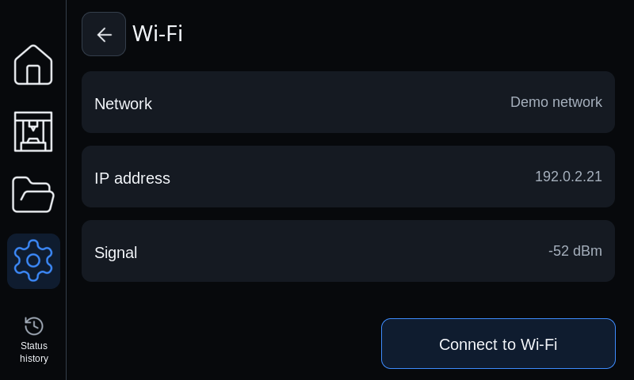 |

| Available networks | Password entry |
| --- | --- |
|  |  |

| Scanning | Connecting |
| --- | --- |
| 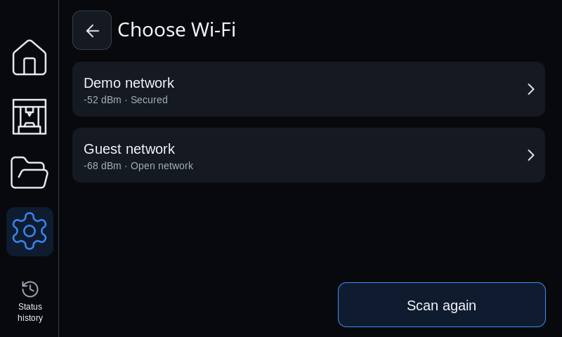 |  |

| Connected | Connection failed |
| --- | --- |
| 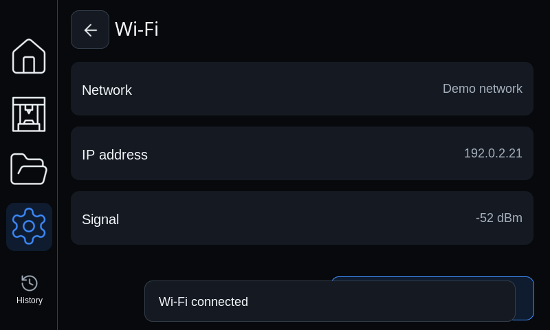 | 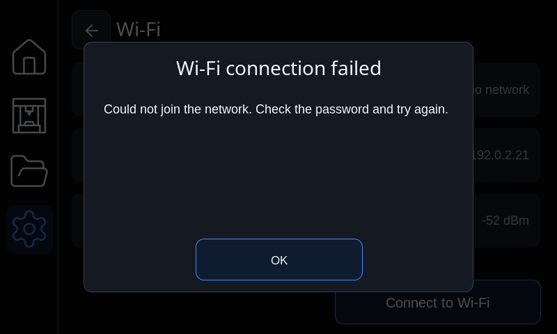 |

### Time-lapse and storage

- Enable/disable recording when the time-lapse component is available, including during printing.
- Save recordings to USB or confirm deletion using the icons beside each recording.
- View printer/USB storage, eject or format when allowed. Ejected drives stay
  unavailable until remounted. Restricted operations explain why they cannot run during printing.

| Time-lapse settings | Recordings |
| --- | --- |
|  |  |

| Storage | USB actions |
| --- | --- |
|  |  |

### System

- View machine/software information, choose a time zone and open logs/history.
- Restart Klipper or controller firmware with confirmation, including during a
  print. The warning explains that the print cannot continue.

| System | Machine information |
| --- | --- |
|  |  |

| Software version | Time zone |
| --- | --- |
|  |  |

| Help and logs | Restart options |
| --- | --- |
|  |  |

| Restart Klipper | Restart controller firmware |
| --- | --- |
|  |  |

## Uninstall and return to HarkScreen

The helper reinstalls upstream K2 OpenKlipper with HarkScreen, not Creality
firmware. Finish prints and printer operations, then run over SSH on the printer:

```sh
sh /mnt/UDISK/openklipper-screen/uninstall.sh --check
sh /mnt/UDISK/openklipper-screen/uninstall.sh
```

- `--check` verifies the replacement without stopping or removing the native screen.
- Uninstall stops both native processes, performs a full upstream reinstall and
  verifies HarkScreen before removing native runtime files and display settings.
- Restores missing HarkScreen display settings from the newest available installer backups, then restarts HarkScreen to load them. Existing HarkScreen settings take priority.
- Keeps the current system timezone; restored `auto` follows that timezone.
- Printer configuration, G-code files and installer backups are retained.
  If replacement fails, native files are kept.

The helper prevents two interfaces drawing on the same display. It selects the
latest public upstream release, including prereleases, and uses that same version
for checking and installation. With no published releases, it uses upstream `main`.
Pass `--ref <tag>` to choose a version. **The full reinstall can restart printer
control; do not run it during a print.**

## License

Licensed under the [GNU General Public License version 3](LICENSE).
Third-party libraries, fonts and icons retain their own notices in `assets/`
and `precompiled/armv7/licenses/`.

## For developers

The [developer guide](developer-tools/README.md) covers architecture, builds,
local previews, tests and packaging. Bundled [preview cases](developer-tools/fixtures/README.md)
use synthetic data without connecting to a printer.

### Contributing

Report bugs and suggest improvements through [Issues](https://github.com/carmanspb/K2-OpenKlipper-Touchscreen/issues).
Code changes go through pull requests reviewed by @carmanspb. Read the
[contribution guidelines](CONTRIBUTING.md) before submitting a PR.
