# Native touchscreen

A fast, responsive native LVGL interface for **K2 OpenKlipper**. It installs and
updates with K2 OpenKlipper using the included precompiled package; no separate
installation or compilation on the printer is needed.

Printer identity, heater and travel limits, homing state and available features
come from the printer configuration. The interface is currently in English.
The screenshots below are rendered by the native application with example data.

## Home

- Idle Home shows the printer illustration, automatically with or without CFS.
- Tap temperature tiles to change targets; open files, filament controls or fans,
  and switch the light.

| Idle with CFS | Idle without CFS |
| --- | --- |
|  | 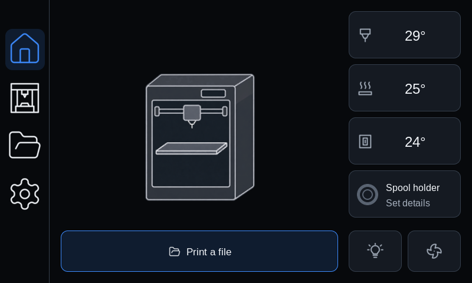 |

### During a print

- See the model preview, progress, remaining hours/minutes and `Layer current / total`.
- Pause, stop or open the plate view to skip failed objects.
- Tap the status text or history icon to open **Status history**. One or two lines
  are centered beside CFS; longer messages end with an ellipsis.
- CFS colors and the nozzle marker show available and feeding filament.
- The light icon shows its current state: rays when on, a crossed bulb when off.
  Light and fan shortcuts remain available; filament colors do not follow the UI accent.

| Printing | Heating toward targets |
| --- | --- |
|  |  |

| Long status message | Long time and layer counts |
| --- | --- |
|  |  |

| Hours and minutes remaining | Dark model preview |
| --- | --- |
|  |  |

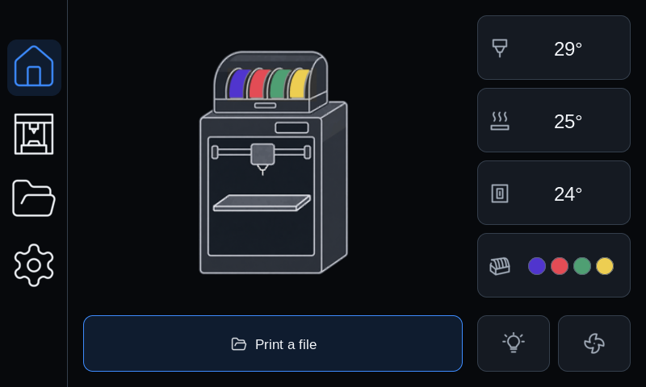

### Temperatures

- Choose a preset or tap the target for numeric entry. Limits follow configuration.
- While approaching a target, tiles show current → target; near the target they
  show the current value alone. Display rounding is stabilized to reduce flicker.
- Targets stay editable while heating. Calibration and filament safety locks still apply.

| Nozzle target | Numeric entry |
| --- | --- |
|  |  |

| Bed target | Chamber target |
| --- | --- |
|  |  |

### Activity, messages and recovery

- Routine work uses a small sidebar spinner with a short caption, such as
  **Homing**, **Loading filament** or **Refreshing files**. Navigation stays available.
- The badge disappears on completion and is hidden when idle. Progress already
  shown on the current page is not duplicated; printing alone creates no badge.
- Tap an active badge for history. When idle, use **System → Help & logs**.
- Errors appear as dialogs even during an operation. Calibration blocks choosing
  another print; homing alone still allows browsing files.

| Homing | Reading a file |
| --- | --- |
|  |  |

| Calibration in progress | Printer error |
| --- | --- |
|  |  |

| Notice | Status history |
| --- | --- |
|  |  |

| Recent errors | Printer startup |
| --- | --- |
|  |  |

Startup stays on a loading screen until printer control and initial state are
ready. Losing Klipper or an MCU replaces controls with recovery actions; losing
the local touchscreen service shows a separate reconnecting screen. Recovery
returns to the previous page automatically.

| Printer connection lost | MCU or Klipper shutdown |
| --- | --- |
|  | 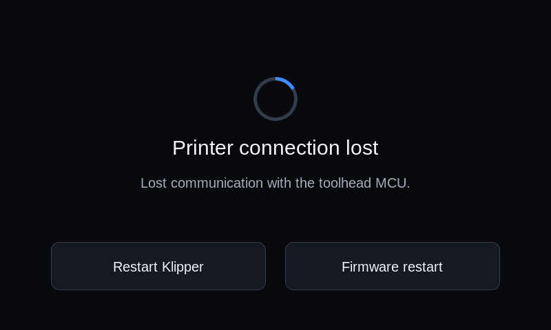 |

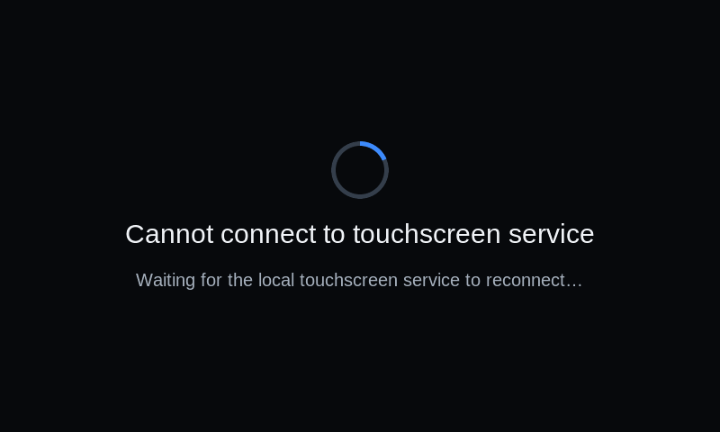

## Printer controls

### Move

- Home, jog X/Y and Z, or tap a coordinate to enter a destination within travel limits.
- Motion and movement-step selection follow homing and operation availability.
  Printing is identified by Klipper print state, not its generic idle timer.
- Extrude/retract only when the nozzle is hot enough and the printer state allows it.
- Unlock motors for manual movement; confirmation warns that the bed may drop.

| Movement | Unlock motors |
| --- | --- |
|  | 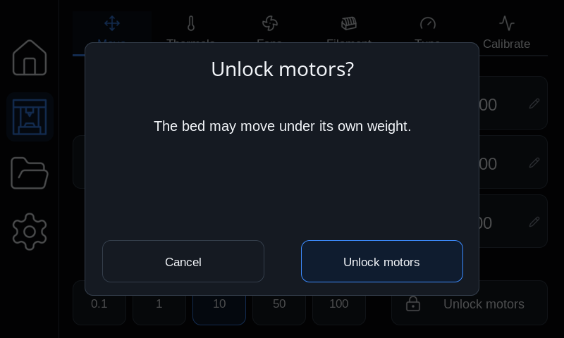 |

### Thermals and fans

- Thermals groups nozzle, bed and chamber targets in three columns.
- **Turn heaters off** is available when idle.
- Touch sliders control part cooling, side cooling and chamber exhaust where supported.
  Hotend cooling stays under firmware control.

| Thermals | Fans |
| --- | --- |
|  |  |

### Filament and CFS

- Select a spool to edit its material, color and nozzle temperature, or Load/Unload.
- The accent border marks selection; the nozzle marker identifies feeding filament.
- Material filters shorten the list. CFS temperature and humidity appear below the spools.
- With one CFS, all five spool tiles share the same height, with temperature and
  humidity centered below them. No unit selector is shown. With multiple reported
  units, two to four selectors share the available width; the spool holder remains separate.
- Without CFS, edit the spool-holder card and feed filament manually. Load/Unload
  buttons are hidden. **Reset** in any spool editor removes its saved details
  with confirmation; it does not move or unload filament.

| One CFS | No CFS |
| --- | --- |
|  | 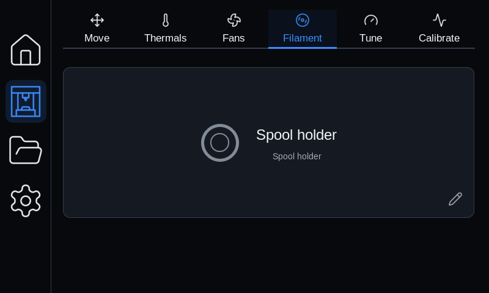 |

| Two CFS units | Three CFS units |
| --- | --- |
| 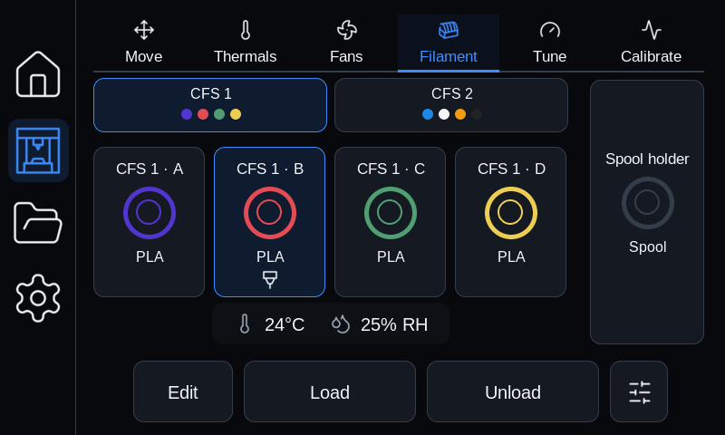 |  |

| Four CFS units | Filament editor |
| --- | --- |
| 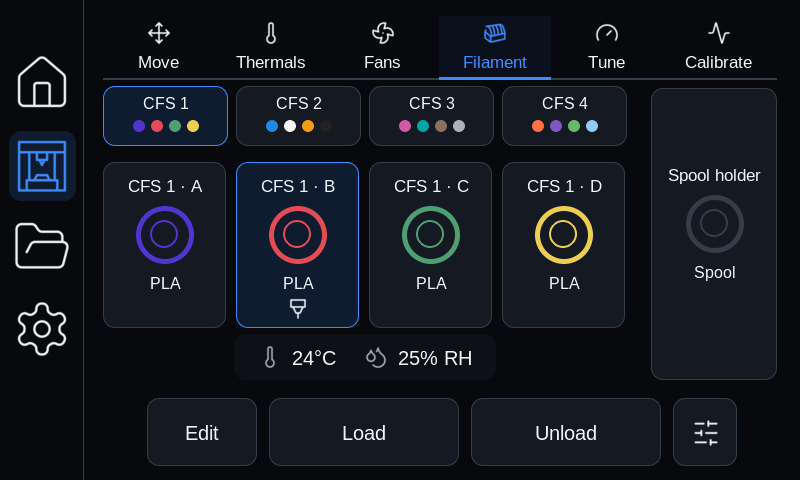 | 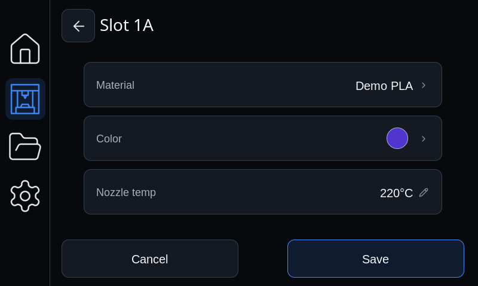 |

| Material filters | Color picker |
| --- | --- |
|  |  |

| Loading filament | Unloading filament |
| --- | --- |
| 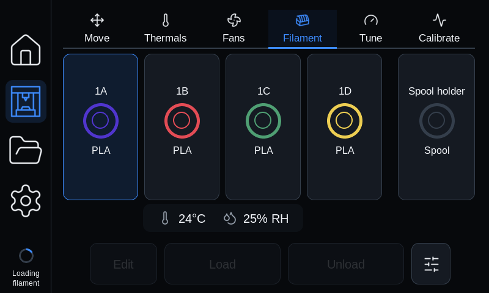 | 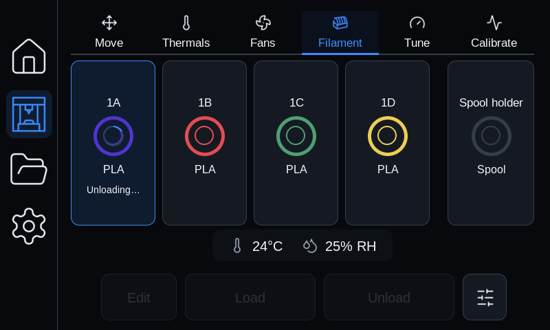 |

| CFS preferences | Automatic refill sequence |
| --- | --- |
| 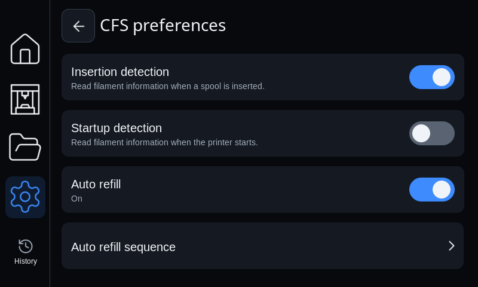 |  |

| Spool-holder editor | Reset confirmation |
| --- | --- |
|  | 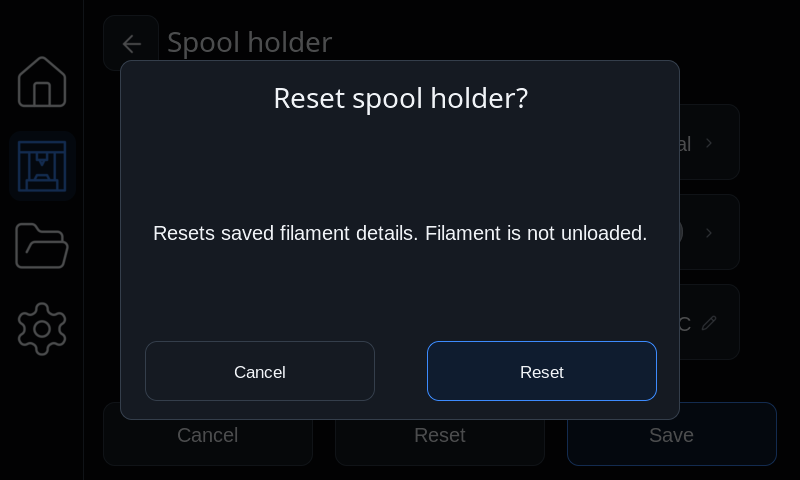 |

Removing CFS filament makes its slot grey/empty and clears the editable details.
Insertion shows **Filament changed**; press **OK** to open the filament page with
that slot selected, then enter its material, color and nozzle temperature. This
manual-entry workflow does not guess material or fill it from an RFID record.

| Slot emptied on removal | Insertion notice |
| --- | --- |
| 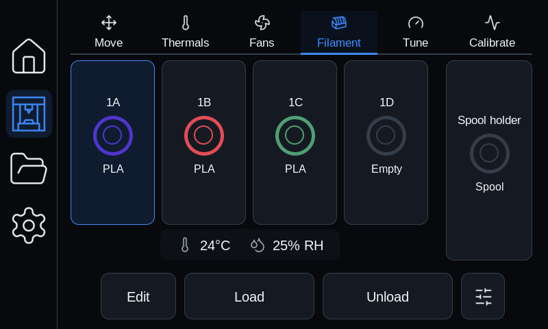 |  |

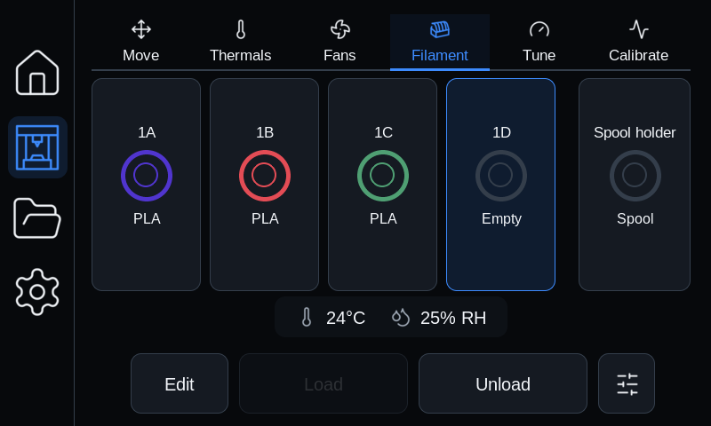

The matching Klipper driver keeps the former profile internally for an in-flight
filament tail's purge temperature and refill matching. It is not offered as the
new spool's details. This flow requires the complete updated installation, not
just replacing the touchscreen binary.

Automatic refill uses loaded slots with matching material and color; the sequence
page shows matching sources. Automatic RFID reading is not exposed as a setting until record updates are supported.

**Multi-unit limitation:** the current OpenKlipper CFS driver operates one configured
unit. Multi-unit screenshots demonstrate the UI; additional hardware support needs
backend work. A single unit's environmental readings are not copied to other units.

### Tune and calibrate

- Tune print speed and flow using steps or numeric entry, up to 200%.
- Adjust Z offset for the current print; each change is limited to 0.1 mm.
- Calibration offers homing, Z tilt, full bed mesh, input shaping, belt tension
  and cutter calibration where supported. Z tilt homes missing axes first.
- Save pending configuration changes with confirmation. Calibration controls are
  replaced by an explanation during printing.

| Print tuning | Calibration |
| --- | --- |
| 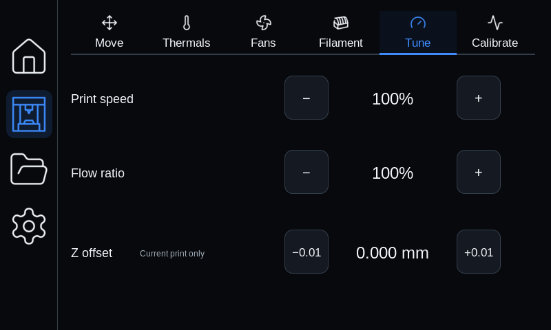 |  |

| Save configuration | Calibration unavailable during printing |
| --- | --- |
|  | 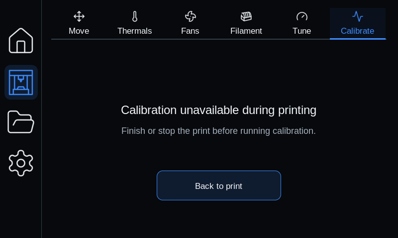 |

## Files and starting a print

1. Browse sliced files with thumbnails or a fallback icon. Refresh keeps the list
   visible and reports progress in the sidebar. File review shows a spinner while
   reading a new preview, then a larger fallback icon if no preview is available.
   Home uses the same fallback during printing. Previous previews are never reused.

   Embedded Creality/Orca PNGs and material metadata are read when Moonraker has
   not extracted them; file names are not used to guess material.
2. Review the preview and print details; select **Calibrate before printing** if available.
3. Match each file filament's color/material to a printer source, then **Start print**.
   Source lists scroll by touch. Incompatible materials are disabled and block starting;
   colors may differ.

- Trash icons open a filename-specific **Cancel / OK** confirmation.
- Other files can be deleted while printing; the active or pending print file is protected.
- Select failed parts on the plate view and confirm skipping them.

| Files | Background refresh |
| --- | --- |
| 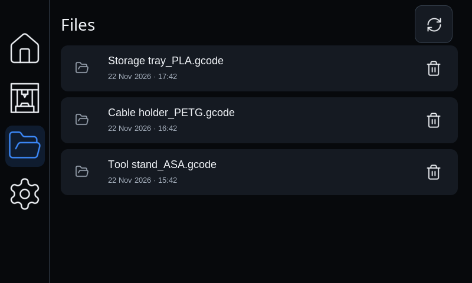 | 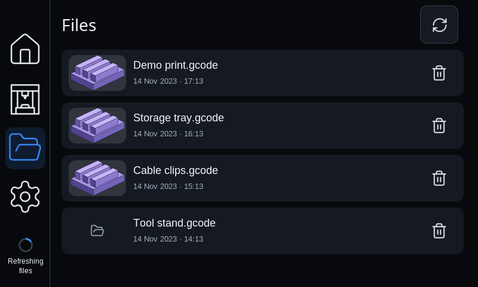 |

| File review | Filament mapping |
| --- | --- |
|  |  |

| Material-aware source picker | Skip print objects |
| --- | --- |
|  | 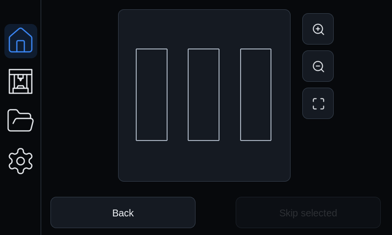 |

| Delete confirmation | Stop-print confirmation |
| --- | --- |
|  |  |

| Reading preview | No embedded preview |
| --- | --- |
|  | 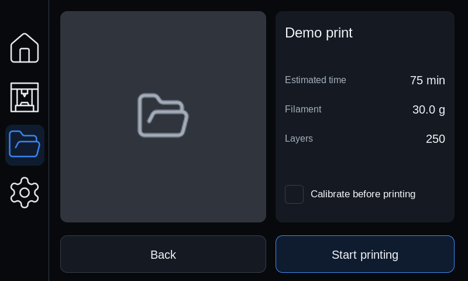 |

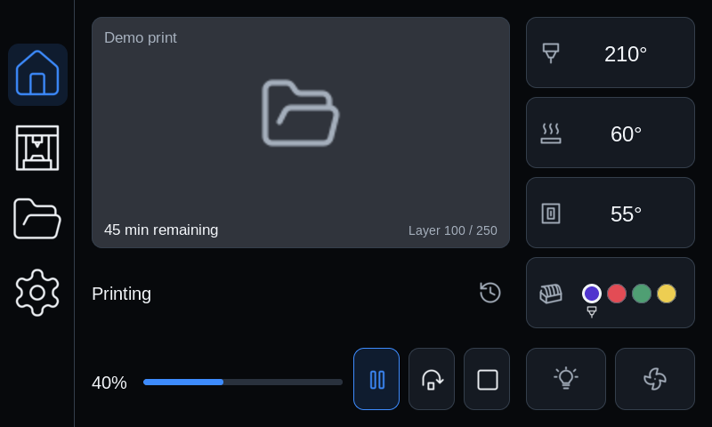

## Settings

### General

- Change brightness and the interface highlight color.
- Set screen sleep, light-off and idle timers. Printing, operations and urgent
  messages keep the screen awake; the first touch wakes it without activating a control.
- Open CFS refill preferences when connected.

| General | Display and appearance |
| --- | --- |
|  |  |

### Network

- View Ethernet and Wi-Fi details; scan networks and enter a password.
- The password hint disappears when typing. A blinking caret marks entry, and
  the eye icon shows/hides the password. Shift is one-shot; double-tap for capitals.
- Scanning and connecting use centered progress screens, followed by success or failure feedback.

| Network | Ethernet |
| --- | --- |
|  | 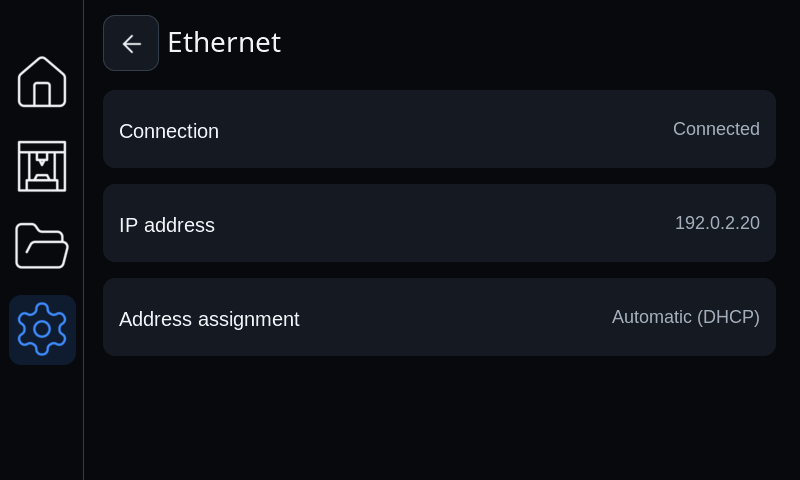 |

| Wi-Fi details | Available networks |
| --- | --- |
|  | 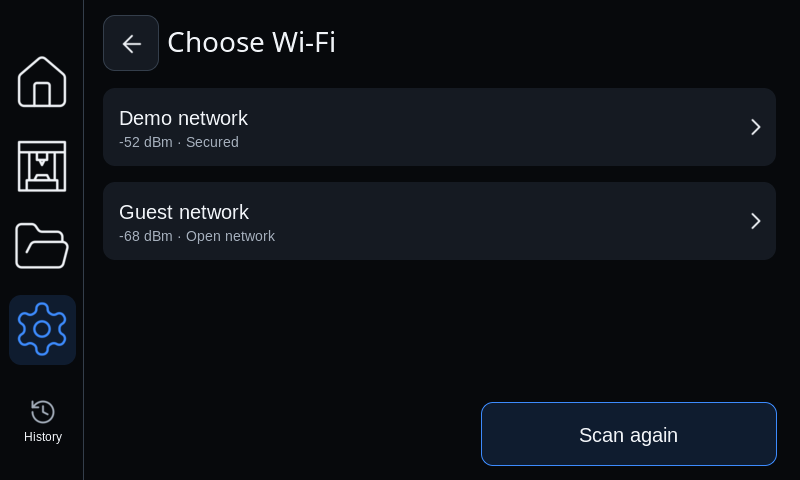 |

| Password entry | Scanning |
| --- | --- |
|  |  |

| Connecting | Connected |
| --- | --- |
|  |  |

### Time-lapse and storage

- Enable/disable recording when the time-lapse component is available, including during printing.
- Save recordings to USB or confirm deletion with the icons beside each recording.
- View printer/USB storage. Eject or format when allowed; an ejected drive stays
  unavailable until remounted. Restricted operations show an explanation during printing.

| Time-lapse settings | Recordings |
| --- | --- |
| 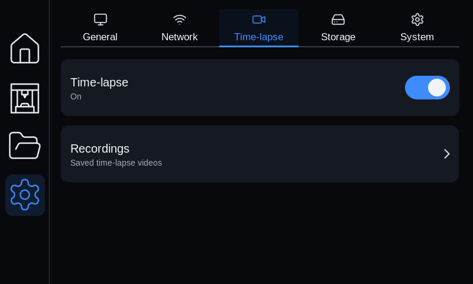 |  |

| Storage | USB actions |
| --- | --- |
| 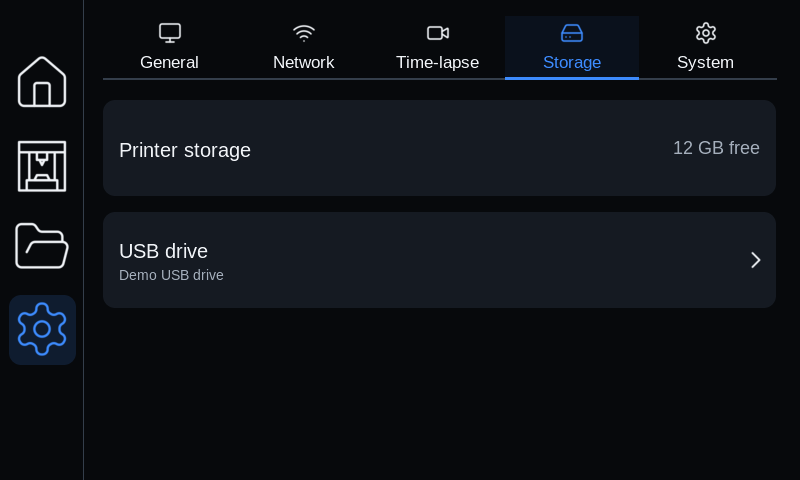 |  |

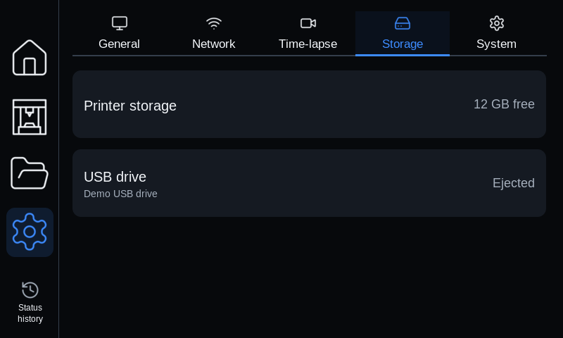

### System

- View machine/software information, choose a time zone and access logs/history.
- Restart Klipper or controller firmware with confirmation, including during a print.
  The warning explains that an ongoing print cannot continue.

| System | Machine information |
| --- | --- |
|  |  |

| Software version | Time zone |
| --- | --- |
|  |  |

| Help and logs | Restart options |
| --- | --- |
|  | 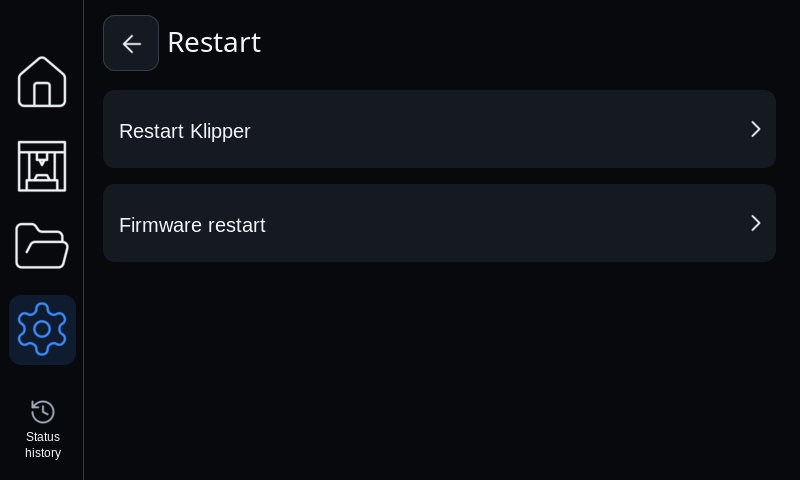 |

| Restart Klipper | Restart controller firmware |
| --- | --- |
| 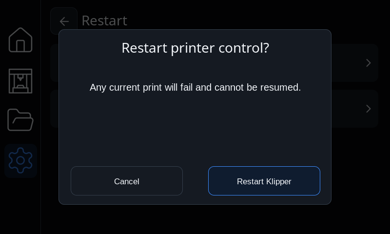 | 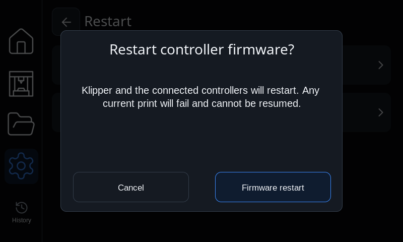 |

## Optional print-failure detection

K2 OpenKlipper's optional [failure watcher](../tools/ai-detect/) runs on an external
PC. Its settings, including automatic pause, live in `/etc/default/k2-detect` on
that PC. It does not expose a touchscreen settings API.

## For developers

The [developer guide](developer-tools/README.md) covers architecture, builds,
local previews, tests and packaging. Bundled [preview cases](developer-tools/fixtures/README.md)
use synthetic data and work without connecting to a printer.
