# Native touchscreen

A fast, responsive native LVGL interface for **K2 OpenKlipper**, with touch
controls for printing, filament and everyday printer settings. It installs and
updates as part of K2 OpenKlipper—no separate touchscreen installation is needed.
Printer identity, temperature limits, travel limits and available controls follow
the printer configuration.

## Interface examples

These screenshots come from the native application using example data. The
interface is currently in English. Available features depend on the printer and
its installed firmware components.

### Home: ready to print

- See the original printer illustration when idle, with or without CFS automatically.
- Tap a temperature tile to set its target.
- Open files, filament controls or fans, and switch the light.

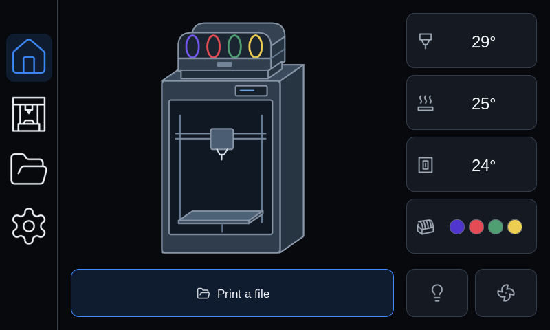

### Home: printing

- See the model preview, remaining hours/minutes, layer count and progress.
- Pause or stop the print, or select failed objects to skip.
- Tap the print status area or its history icon to review printer messages.
- Print status is centered beside CFS and supports two lines, with an ellipsis for longer messages.
- Check spool colors and the feeding-filament marker in the CFS shortcut.

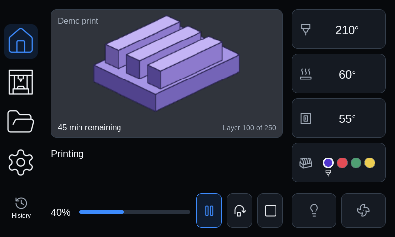

### Set temperatures and watch heating

- Tap the nozzle, bed or chamber tile to change its target.
- Choose a preset or tap the target value for numeric entry.
- Temperature limits follow the printer configuration.
- Change a target again while heating; calibration and filament safety locks still apply.

While heating or cooling toward a target, the tile shows the current temperature
and an arrow to the target. Once the temperature is within range, it shows a
single current value.

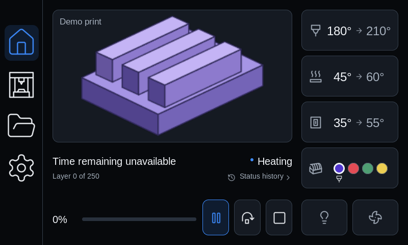

### See what the printer is doing

Routine operations show a compact activity indicator with the operation name in
the sidebar. You can continue navigating; controls that conflict with the
operation become unavailable.

The indicator disappears when the operation finishes. Idle screens have no
activity badge, and printing is represented in the Home status area. Calibration failures
appear immediately as error dialogs. During calibration, the Home file button
shows **Calibration in progress** instead of offering another print. Homing alone
does not block file browsing.

### Startup and connection recovery

- During startup, a full-screen indicator stays visible until printer control,
  configuration and the initial motor handshake are ready.
- If Klipper or an MCU stops responding after connection, a blocking recovery
  screen replaces all printer controls. Restart Klipper or controller firmware
  using the two actions, each with confirmation.
- When a healthy connection returns, the previous page comes back automatically.
- If the local touchscreen service is unavailable, a separate reconnecting screen
  appears without Klipper restart controls.

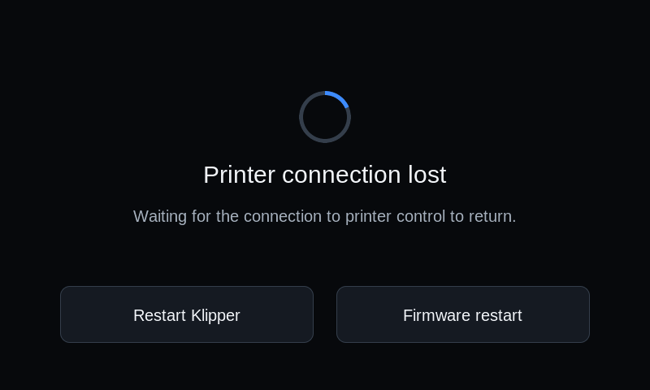

## Printer controls

### Move

- Home the printer, jog X/Y and Z, or enter a destination.
- Movement becomes available after the relevant axes are homed.
- Unlock motors for manual movement.
- Extrude or retract when the nozzle is hot enough and the printer state allows it.

### Thermals

- View nozzle, bed and chamber temperatures together.
- Tap a tile to set its target.
- When idle, use **Turn heaters off** to switch off all heaters.

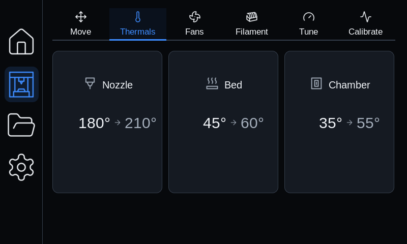

### Fans

- Adjust part cooling, side cooling and chamber exhaust with touch sliders.
- Hotend cooling remains under firmware control.

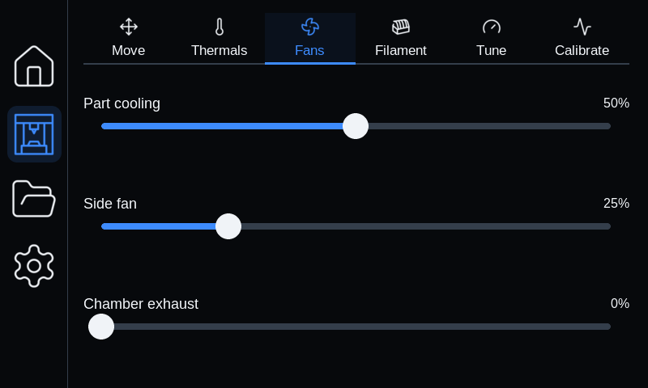

### Filament: one CFS

- Select a spool, then edit its material, color and nozzle temperature, or Load/Unload.
- Use material filters to shorten the material list.
- The nozzle marker identifies feeding filament; the accent border identifies selection.
- Read CFS temperature and relative humidity below the spools.

### Filament: multiple CFS units

- Switch units using the color-dot selectors above the four spools.
- Two, three or four selectors share the available width; the spool holder stays separate.
- With one CFS, the selector is hidden and the spool tiles use the extra height.

This example demonstrates the multi-unit interface. The current OpenKlipper CFS
driver operates one configured unit; additional-unit hardware support requires
backend work. Environmental readings are not duplicated across units when only
one unit's readings are available.

### Filament: no CFS

- Tap the spool-holder card to edit filament information.
- Feed filament into the extruder manually; there are no Load/Unload buttons here.

### Tune

- Adjust print speed and flow ratio with buttons or direct numeric entry, up to 200%.
- Adjust Z offset for the current print with steps or direct entry; each change is limited to 0.1 mm.

### Calibrate

- Run homing, Z tilt, a full bed mesh or input shaping where supported.
- Z tilt homes the axes first when needed.
- Start belt-tension or cutter calibration where supported.
- Save pending calibration changes with **Save configuration**.
- During printing, see an explanation instead of calibration controls.

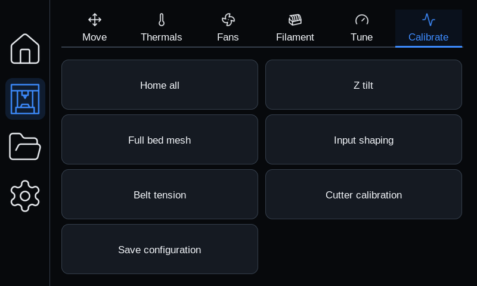

## Choose and start a print

### 1. Browse files

- Browse files with slicer thumbnails, or a fallback icon.
- Tap a file to review it; use the trash icon for Cancel/OK deletion confirmation.
- Delete other files during printing; the active print file stays protected.

### 2. Review the file

- Check the larger preview and print details.
- Choose whether to calibrate before printing.
- Continue to filament selection before starting.

### 3. Match filaments

Match each filament required by the file to a source on the printer. The overview
pairs the requested color/material with the selected source. Tap a source to
choose another available filament; long lists scroll by touch.

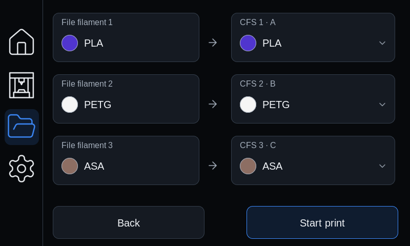

The picker shows the required material and disables incompatible choices. Colors
may differ, but material mismatches block starting the print. Review the mappings,
then choose **Start print**.

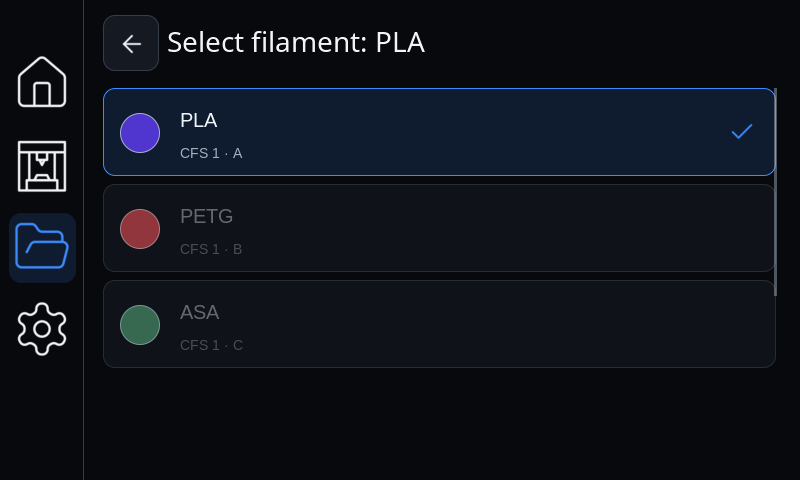

## Settings

### General

- Change brightness and the interface highlight color.
- Set screen, light and idle timers.
- Configure automatic filament reading and refill when CFS is connected.

### Network

- View Ethernet and Wi-Fi connection details.
- Scan for Wi-Fi networks, choose one and enter its password.
- See connection success or failure feedback.

### Time-lapse

- Enable or disable recording when the time-lapse component is available, including during a print.
- Browse recordings, save individual recordings to USB or confirm deletion.

### Storage

- Check available printer storage and connected USB drives.
- Eject or format USB drives when available. Ejected drives remain unavailable until remounted.
- During printing, unavailable storage operations show an explanation.

### System

- View machine information and software versions.
- Set the time zone and access logs.
- Restart Klipper or controller firmware with a confirmation warning.

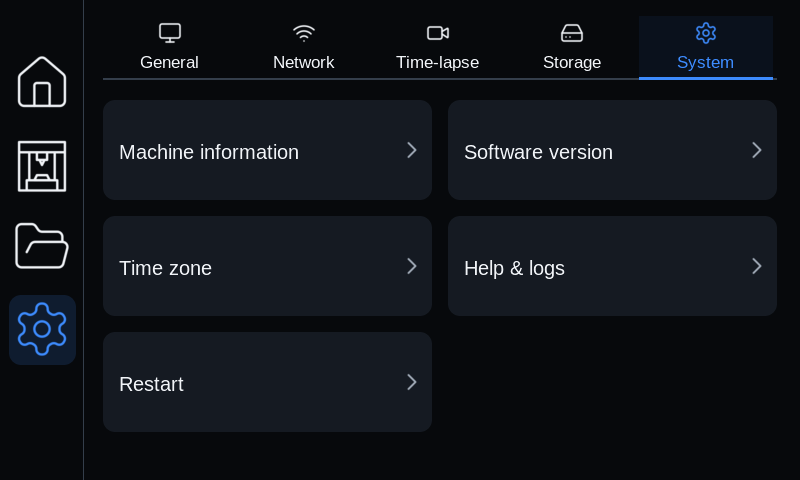

## More interface examples

The galleries below show the supporting screens and dialogs used in these
workflows. Screens that depend on hardware are shown with example connection and
capability data.

### Temperature entry, activity and messages

Temperature controls share the same layout. Numeric entry opens a larger keypad.
The bottom of the sidebar names active work, including **Loading filament**,
**Unloading filament** and **Refreshing files**. Refresh keeps the file list visible.
Progress already shown on the current page is not repeated in the sidebar.
Faults and notices appear separately, with a clear dismissal action.

| Bed temperature | Chamber temperature |
| --- | --- |
|  |  |
| Numeric entry | Reading file |
|  | 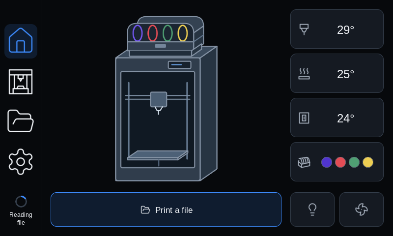 |
| Loading filament | Unloading filament |
|  |  |
| Printer error | Notice |
| 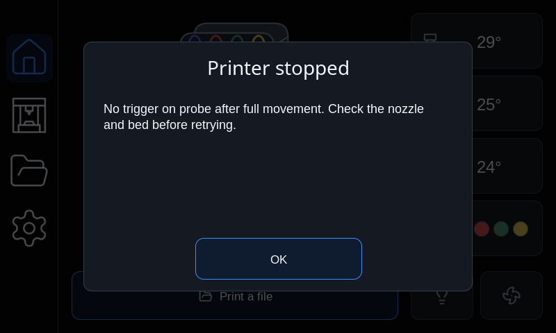 |  |
| Status history | Recent errors |
|  |  |

| File deletion confirmation | Stop-print confirmation |
| --- | --- |
| 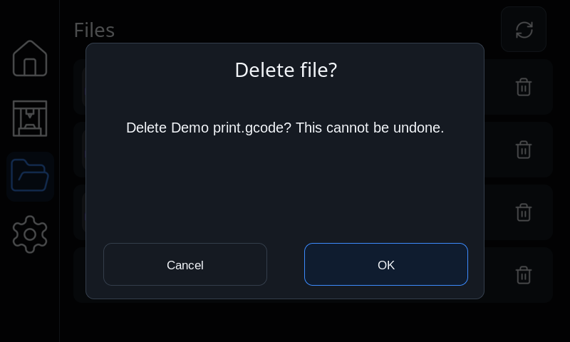 | 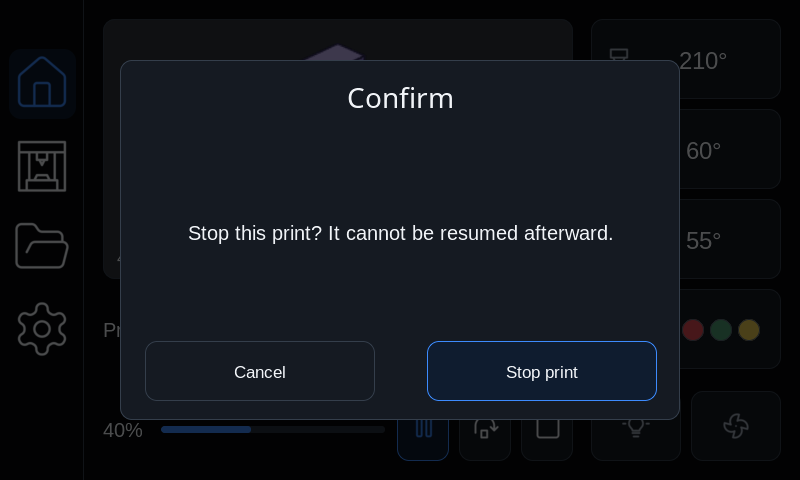 |
| Unlock motors | Printer startup |
|  |  |

### Filament editing and unit selection

Edit material, color and nozzle temperature from the slot editor. Material
filters and the color picker keep common choices within reach. The unit selector
shows only the reported CFS units; changing the viewed unit does not load filament.

| Two CFS units | Three CFS units |
| --- | --- |
|  |  |
| Filament editor | Material selection |
|  |  |
| Color selection | CFS preferences |
| 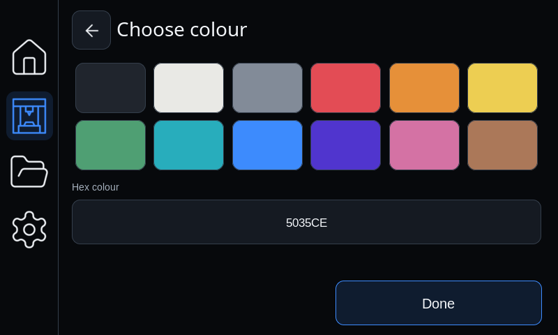 |  |
| Automatic refill sequence | Print object selection |
| 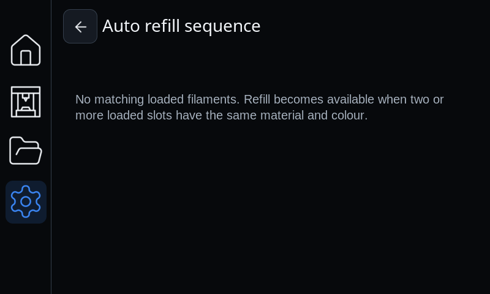 |  |

Automatic refill uses loaded slots with matching material and color. The sequence
screen shows the available matching sources. Object selection shows the plate and
part outlines: select failed parts, then confirm skipping them.

### Display and network details

Display settings control brightness and the interface highlight color. Network
pages distinguish Ethernet from Wi-Fi. For a secured wireless network, enter the
password with the on-screen keyboard; the eye icon shows or hides it.

| Display and appearance | Ethernet details |
| --- | --- |
| 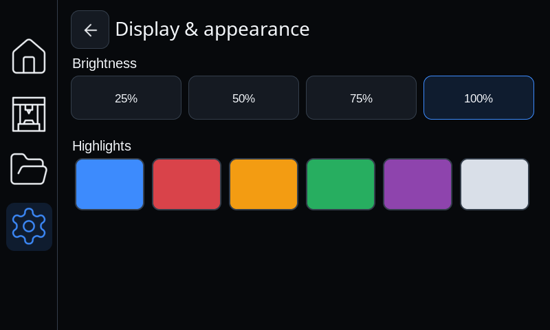 |  |
| Wi-Fi details | Available networks |
|  |  |
| Password entry | Successful connection |
| 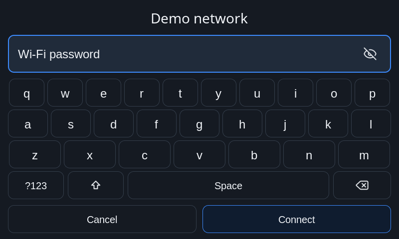 |  |
| Connection failure | USB drive details |
|  |  |

### Recordings and system details

Saved recordings provide individual USB-save and delete actions. System pages
show printer/software information, time-zone selection and logs. Saving
configuration and restarting require deliberate confirmation; unavailable
calibration shows an explanation instead of live controls.

| Saved recordings | Machine information |
| --- | --- |
|  | 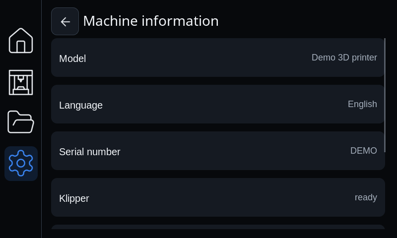 |
| Software versions | Time zone |
|  |  |
| Help and logs | Restart choices |
| 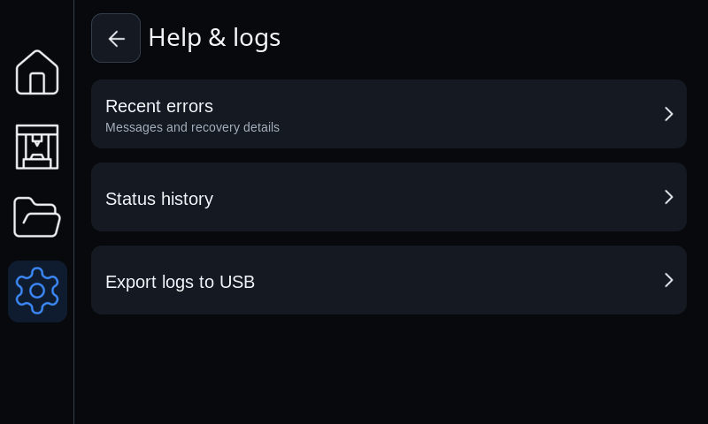 |  |
| Restart Klipper confirmation | Firmware restart confirmation |
|  |  |
| Save configuration | Calibration during a print |
| 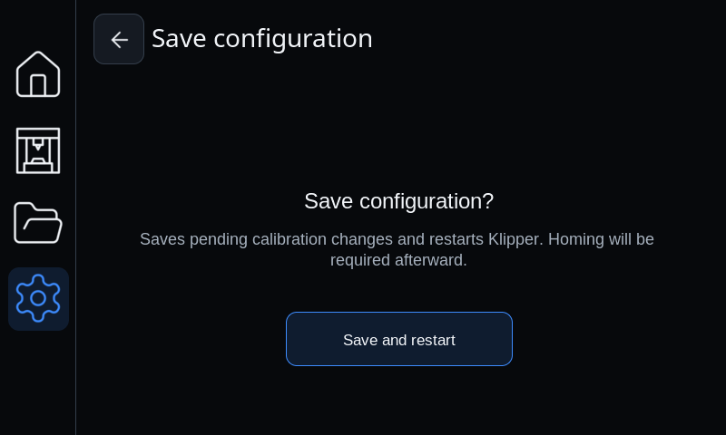 |  |

## For developers

See the [Native touchscreen developer guide](developer-tools/README.md) for
architecture, Linux builds, local previews, testing and packaging. Portable
[preview cases and artwork](developer-tools/fixtures/README.md) are included in
the repository.

### More workflow examples

| Longer print and readable dark preview | Calibration activity |
| --- | --- |
| 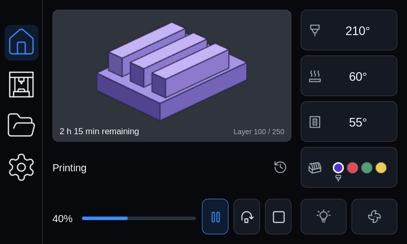 |  |
| 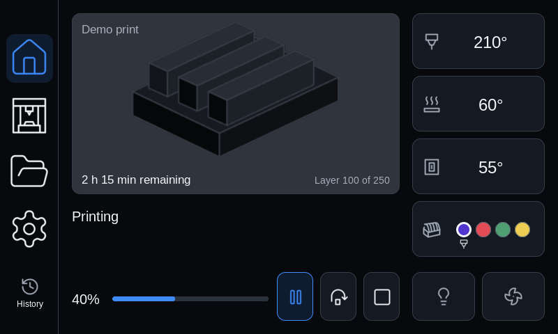 |  |

| Finding networks | Connecting to the chosen network |
| --- | --- |
|  | 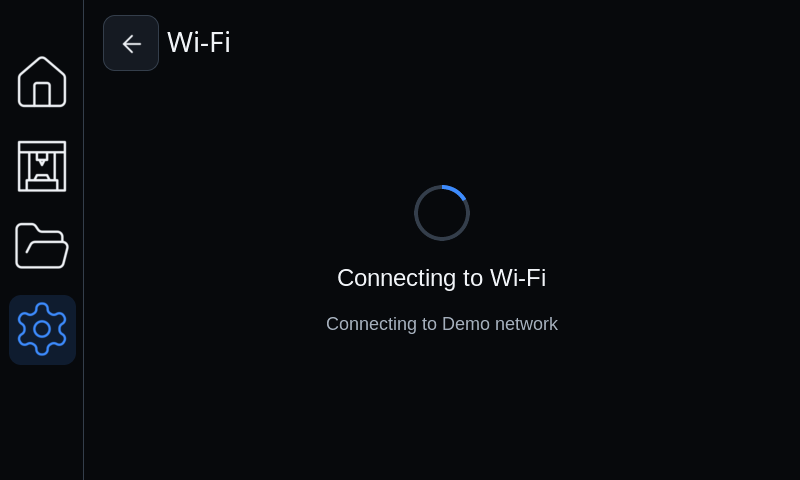 |

The password field has a blinking caret and a muted hint that disappears when
you type. The password keyboard uses one-shot Shift; double-tap Shift for capitals until
you tap it again. Restart controls remain available during a print, with a warning
that the print cannot continue.

| Long print and high layer counts | Long print status |
| --- | --- |
|  |  |

### Optional print-failure detection

K2 OpenKlipper includes an optional failure watcher for an external PC, using
Obico and a local vision model. Its settings, including automatic pause, live on
that PC in `/etc/default/k2-detect`. It does not expose a touchscreen settings
API. See [the upstream watcher implementation](../tools/ai-detect/) for setup.

### Refresh without blocking browsing

The file list stays in place while **Refreshing files** appears in the sidebar.
The badge disappears when the read completes. Tap an active badge to open status
history; history is also available under **Help & logs** when idle.

