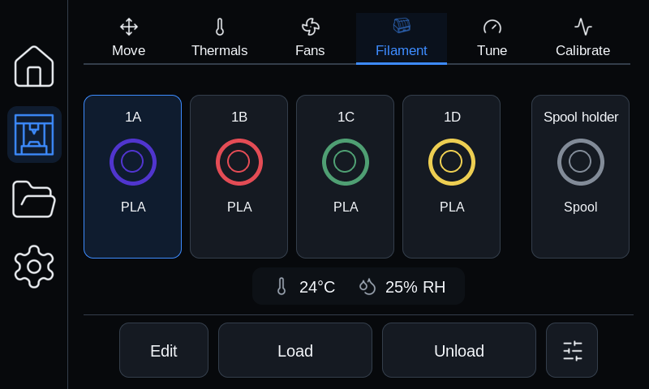

# Native touchscreen

A native LVGL interface for K2 OpenKlipper, with touch controls for printing,
filament, calibration and everyday printer settings. Printer identity, temperature
limits, travel limits and available features come from the printer configuration.

## Installation

The native touchscreen is installed and updated by the **normal K2 OpenKlipper
installer**. Use the [project installation guide](../docs/INSTALL.md) with the
installer from the version you are installing. When testing a fork or branch,
select that repository and ref through the installer's existing `OKL_REPO` and
`OKL_REF` options.

The small `main/install.sh` download is the installer entry point. Unless you
set `OKL_REF`, it selects the newest published release tag, including alpha
releases. A failed release lookup stops installation instead of selecting `main`.

The ready-built ARM executable, icons and licenses ship in `precompiled/armv7/`.
No separate touchscreen download, compilation or font generation is needed on
the printer. The installer checks that the compiled package matches its source,
preserves local printer settings, and retains the normal rollback path to stock
firmware.

## Printing at a glance

View the print preview, progress, remaining time and layers. Temperature tiles
open nozzle, bed and chamber controls. A CFS shortcut beside the preview shows
spool colors and marks the filament feeding the nozzle. Light, fans, pause, stop,
object exclusion and status history remain within reach.

## Printer controls

Move axes, enter positions, heat the nozzle and extrude or retract filament.
Unknown positions disable movement until homing. Lock/unlock controls distinguish
motor holding state from homing. Calibration actions follow the printer's
capabilities. Routine operations show a compact activity indicator while
navigation stays available.

## Filament and CFS

Select a spool, load/unload, or edit its material, color and nozzle temperature.
Material filters shorten the selection list. Connected CFS units and the external
spool are handled from the same workflow, with CFS temperature and humidity shown
when reported.

Before printing, map each file filament to a printer filament. The picker states
the required material and disables incompatible choices. Colors may differ;
material mismatches block Start print. Long lists scroll by touch.

## Files and recordings

Browse printer files and review a file before printing. Each list row has a trash
icon with a filename-specific Cancel/OK confirmation. Saved time-lapse recordings
use the same deletion flow and can be exported to USB when the time-lapse
component and a USB drive are available.

## Settings

Adjust brightness and highlight color, screen/light/idle timers, CFS preferences,
network connections and time zone. System pages show machine information,
software information and restart controls. Unavailable operations explain why
instead of showing active controls.

Screenshots are rendered by the native application with example data. Controls
and limits on a real printer depend on its configuration. The current interface
is in English.

## For developers

Build, desktop preview, architecture, tests and packaging are covered in the
[Native touchscreen developer guide](developer-tools/README.md). All developer
utilities live in `developer-tools/`; layout and behavior are implemented in the
native source and Python backend. Keep hardware-specific changes in printer
configuration or a separate integration branch.
